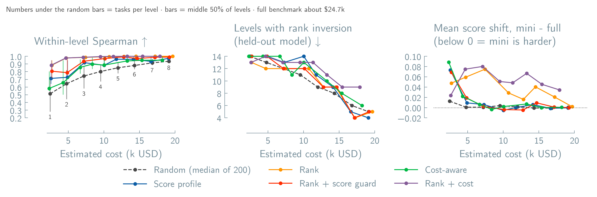
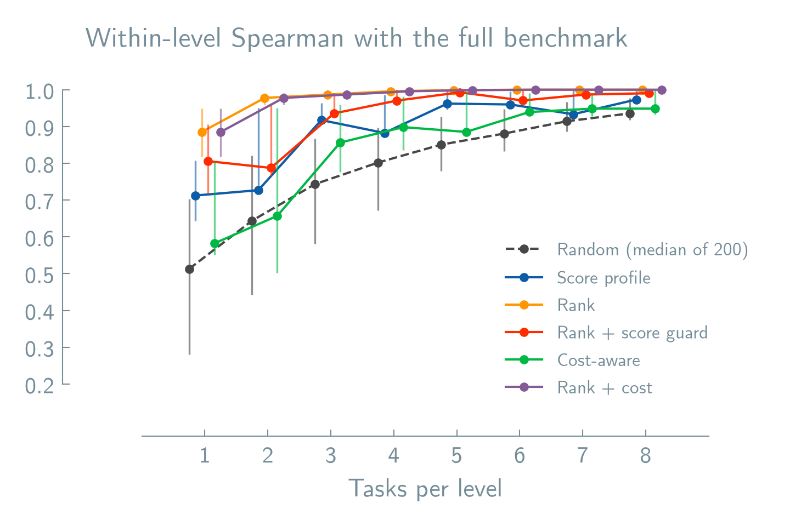
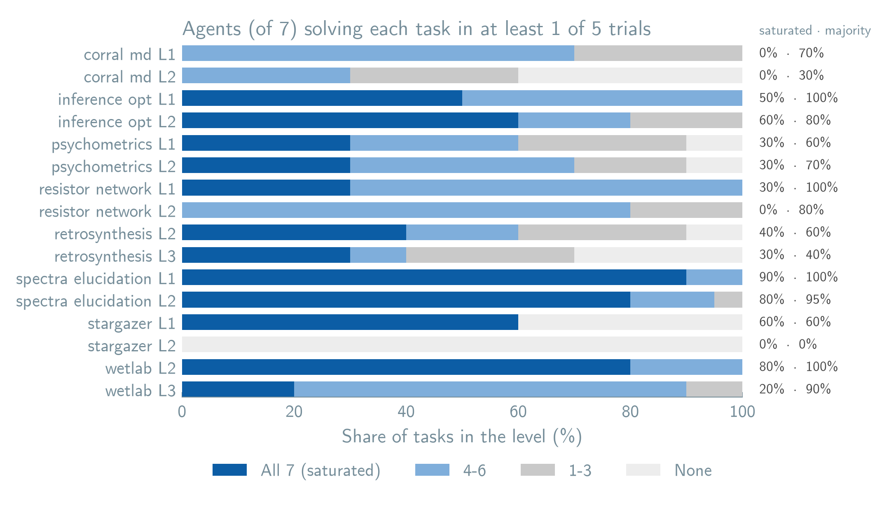
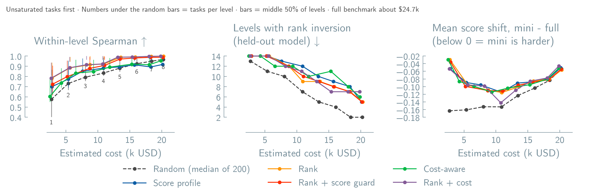
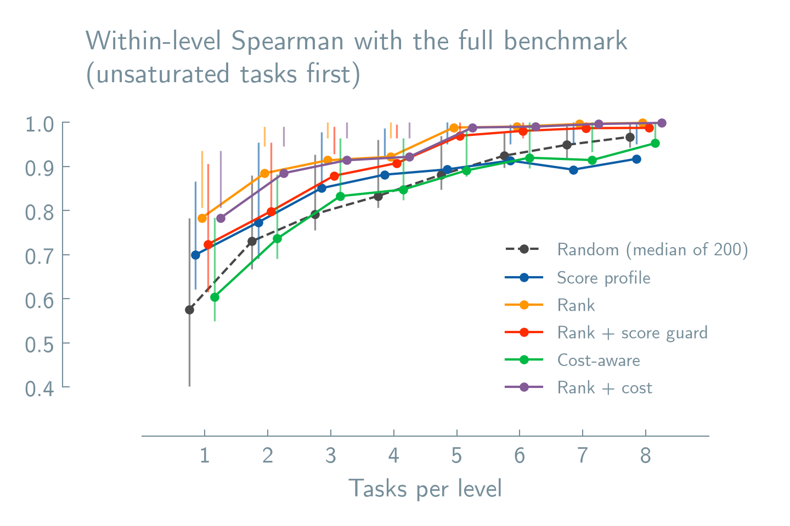

# Corral mini

A small, reproducible subset of the Corral benchmark tasks. It picks the same
number of tasks, *k*, from each of the 16 environment/levels (AFM excluded),
using results from the final reports. **The selection method has not been
chosen yet.** Two candidates exist, both score profile with k = 4 (64 tasks):
`manifest.json` draws from all tasks, and `manifest_unsaturated.json` prefers
unsaturated tasks (see [Unsaturated tasks first](#unsaturated-tasks-first)).

## Run

Pin the Hugging Face summary dataset by its full commit hash (current source:
`6d8dc71d6bcc3a3c6c76a28609f4f4a510ea2dd8`). Add `--tasks-parquet PATH` to
use a local copy of the `tasks` table.

```bash
# 1. Write manifest.json for one method and k
python scripts/build_corral_mini.py --revision <HASH> --method profile --k 4

# 2. Compare all methods for k = 1..8 -> results.csv, saturation.csv
python scripts/compare_corral_mini.py --revision <HASH>

# Same two steps, preferring unsaturated tasks
#   -> manifest_unsaturated.json, results_unsaturated.csv
python scripts/build_corral_mini.py --revision <HASH> --exclude-saturated
python scripts/compare_corral_mini.py --revision <HASH> --exclude-saturated

# 3. Plot every results CSV present -> figures/ (*_unsaturated for that run)
uv run --no-project --with "lama-aesthetics @ git+https://github.com/lamalab-org/lama-aesthetics@f9aaa7e58b66cd4698ea59a6785c24a841221dd2" \
  python scripts/plot_corral_mini.py
```

To run the mini, pass each ID in `tasks_by_environment` with `bench --task`
(the flag can be repeated).

## Methods

Each method runs separately in every environment/level. Apart from random,
each one tries every possible *k*-task combination, and ties go to the first
combination in task-ID order. "Score" means an agent's mean Pass@5 on the
chosen tasks, and the target is the same agent's score on all tasks of that
level.

| Method | Picks the combination that… | Catch |
|---|---|---|
| **Random** | Is drawn uniformly. Results are the median of 200 seeded draws. | Baseline. A single draw can be much worse than the median. |
| **Score profile** | Has the smallest mean squared error between mini and full agent scores. | Keeps scores close but not the ordering. Dips at k = 4 and 7 instead of improving steadily. |
| **Rank** | Has the highest Spearman correlation between mini and full agent ranking. Ties go to the lower score error. | Overfits the ranking: one agent's level score can be off by 0.4 at k = 4. |
| **Rank + score guard** | Has the highest Spearman among combinations that pass the **score guard**. | Ranking ends up slightly below Rank. |
| **Cost-aware** | Is cheapest among combinations that pass the **score guard**. | Ranking quality changes unpredictably with *k*. |
| **Rank + cost** | Has the highest Spearman. Ties go to the cheapest. | Same ranking as Rank for less money, but generalizes worse to a held-out model. Ignores score error. |

**Score guard:** a combination passes when its worst per-agent score error is
within **0.02** of the smallest worst-case error any combination in that level
can achieve.

**Cost:** each task's estimated USD is summed over the 7 observed agents ×
5 trials. Tokens are priced at the 2026-10-27 list prices in
[`prices.json`](prices.json), with no cache discounts. Running the full
benchmark this way is about $24.7k. The cost of a future run depends on that
run's models.

## How methods are scored

All metrics use the 7 agent/model combinations that ran every task.

- **Ranking kept**: Spearman correlation between mini and full agent ranking,
  computed within each level and averaged over the 15 informative levels.
  Stargazer level 2 is left out because every agent scores 0 there.
- **Ordering loss**: two agents at least **5 points** apart in Pass@5 on the
  full level are tied or reversed on the mini. *Levels with a loss* counts
  levels with at least one such pair.
- **Held-out model**: hide one model (every agent using it), select tasks
  using only the other agents, and check whether pairs involving the hidden
  agents keep their order. This is repeated for each of the 3 models. It
  stands in for "a new model arrives", and it is the fairest test for methods
  fitted to the agents in the reports.
- **Worst level score error**: the largest absolute gap between mini and full
  Pass@5 for any agent in any level.
- **Mean score shift**: mini minus full Pass@5, averaged over every agent and
  level. Below 0 means the mini is harder. Errors in opposite directions
  cancel, so a shift near 0 does not mean every score is accurate.

## Results





Ranking points are the mean over the 15 informative levels. The vertical bar
on each point spans the 25th–75th percentile of those levels, so a long bar
means the method keeps the ranking in some levels and loses it in others. On
the task-count plot, methods are shifted slightly sideways so bars do not
overlap. On the score-shift panel, methods fitted to scores sit at 0. The
rank methods make the mini slightly easier, Rank + cost the most (about
+0.05), because cheap tasks tend to be easy. All numbers are in
[`results.csv`](results.csv).

| k (tasks) | Method | Ranking kept | Levels with a loss | …held-out model | Worst score error | USD |
|---|---|---:|---:|---:|---:|---:|
| 4 (64) | Random | 0.80 | 11 | 11 | 0.42 | 9.5k |
| | Score profile | 0.88 | 5 | 14 | 0.13 | 10.0k |
| | Rank | **1.00** | 1 | 12 | 0.40 | 10.7k |
| | Rank + score guard | 0.97 | 5 | 12 | **0.12** | 10.1k |
| | Cost-aware | 0.90 | 7 | **11** | 0.13 | **8.4k** |
| | Rank + cost | **1.00** | 1 | 13 | 0.42 | 9.5k |
| 5 (80) | Random | 0.85 | 9 | 9 | 0.33 | 12.0k |
| | Score profile | 0.96 | 5 | 11 | **0.10** | 11.7k |
| | Rank | **1.00** | **0** | **9** | 0.20 | 12.8k |
| | Rank + score guard | 0.99 | 1 | **9** | **0.10** | 12.8k |
| | Cost-aware | 0.89 | 8 | 13 | 0.11 | **10.0k** |
| | Rank + cost | **1.00** | **0** | 13 | 0.42 | 11.3k |

## Caveats

- **The numbers are in-sample.** Every method except random is fitted to the
  same 7 agents it is scored on. Use the held-out-model column to judge how a
  method generalizes. Even at k = 5, every method loses an ordering for a new
  model in 9 or more of the 15 levels. The mini is better suited to overall
  rankings than to per-level ones.
- **Ranking and score accuracy trade off.** Rank alone distorts scores, and
  score profile alone gives a weaker ranking. The score guard is a compromise
  between the two.
- **Small *k* is coarse.** With 4 tasks, a level score can only move in steps
  of 0.25 Pass@5, so ties are common, and a tie counts as an ordering loss.
- Every level gets equal weight, so spectra elucidation's 20-task pool does
  not dominate. Most levels have only 10 tasks, so k = 8 already covers 80% of
  them.
- Optimizing pairwise ordering instead of Spearman was tested and dropped; it
  made no meaningful difference.

## Task saturation



An agent counts as solving a task if it passes in at least 1 of its 5 trials.
A task is **saturated** when all 7 agents solve it. **Majority** is 4 or more
agents, saturated tasks included. The counts are in
[`saturation.csv`](saturation.csv). 77 of 180 tasks are saturated.
Spectra elucidation (80–90%) and wetlab L2 (80%) are mostly saturated, while
stargazer L2 has no task any agent solves.

Saturated tasks still carry a little signal. Pass@5 here is estimated from
the pass rate (1 pass in 5 trials gives 0.67, 5 in 5 gives 1.0), so in 48 of
the 77 saturated tasks, agents' Pass@5 still differ.

## Unsaturated tasks first

The same six methods, but each level picks only from its unsaturated tasks
(as defined above). A level with fewer than k unsaturated tasks takes all of
them and fills the remaining slots with saturated tasks, chosen by the same
method. This affects spectra elucidation L1 and wetlab L2 (2 unsaturated
tasks each), and inference L2, spectra elucidation L2 and stargazer L1 (4
each). In the held-out-model check, saturation is judged only on the agents
used for selection. Results are still compared against the **full** level.





All tasks → unsaturated tasks first. Numbers are in
[`results_unsaturated.csv`](results_unsaturated.csv).

| k | Method | Spearman | Rank inversion, held-out model | Max. abs. error | Saturated tasks used | USD |
|---|---|---:|---:|---:|---:|---:|
| 4 | Random | 0.80 → 0.83 | 11 → **7** | 0.42 → 0.80 | 24 → 4 | 9.5k → 10.9k |
| | Score profile | 0.88 → 0.88 | 14 → 12 | 0.13 → 0.80 | 23 → 4 | 10.0k → 10.9k |
| | Rank | 1.00 → 0.92 | 12 → 9 | 0.40 → 0.80 | 23 → 4 | 10.7k → 10.9k |
| | Rank + score guard | 0.97 → 0.91 | 12 → 10 | 0.12 → 0.80 | 22 → 4 | 10.1k → 11.0k |
| | Cost-aware | 0.90 → 0.85 | 11 → 12 | 0.13 → 0.80 | 23 → 4 | 8.4k → 9.3k |
| | Rank + cost | 1.00 → 0.92 | 13 → 11 | 0.42 → 0.80 | 26 → 4 | 9.5k → 10.8k |
| 5 | Random | 0.85 → 0.88 | 9 → **5** | 0.33 → 0.60 | 30 → 9 | 12.0k → 13.4k |
| | Score profile | 0.96 → 0.89 | 11 → 10 | 0.10 → 0.60 | 34 → 9 | 11.7k → 13.4k |
| | Rank | 1.00 → 0.99 | 9 → 9 | 0.20 → 0.60 | 29 → 9 | 12.8k → 13.6k |
| | Rank + score guard | 0.99 → 0.97 | 9 → 9 | 0.10 → 0.60 | 31 → 9 | 12.8k → 13.5k |
| | Cost-aware | 0.89 → 0.89 | 13 → 10 | 0.12 → 0.60 | 31 → 9 | 10.0k → 11.8k |
| | Rank + cost | 1.00 → 0.99 | 13 → 9 | 0.42 → 0.60 | 31 → 9 | 11.3k → 13.1k |

What changes:

- **Random gains the most.** Its held-out rank inversions drop from 11 to 7
  levels at k = 4, and from 9 to 5 at k = 5, the best of any method in either
  run. Unsaturated tasks are informative, so any draw from them works well,
  and random cannot overfit the 7 agents the way the fitted methods do.
- **Fitted methods lose in-sample ranking but gain little on held-out
  models.** With fewer candidate tasks, Rank drops from 1.00 to 0.92 at
  k = 4. Its held-out result improves (12 → 9), but most other methods move
  by only 0 to 2 levels.
- **The mini is harder for every method.** Scores shift down by 0.1–0.15 on
  average at k = 4–5, compared with about 0 for the fitted methods on all
  tasks. The worst cases come from short levels
  that must use their few hard tasks: spectra elucidation L2 at k = 4 puts one
  agent 0.80 below its full score. Treat these as harder subsets, not as
  estimates of the full score.
- **It costs about 2–18% more,** because unsaturated tasks run longer.
