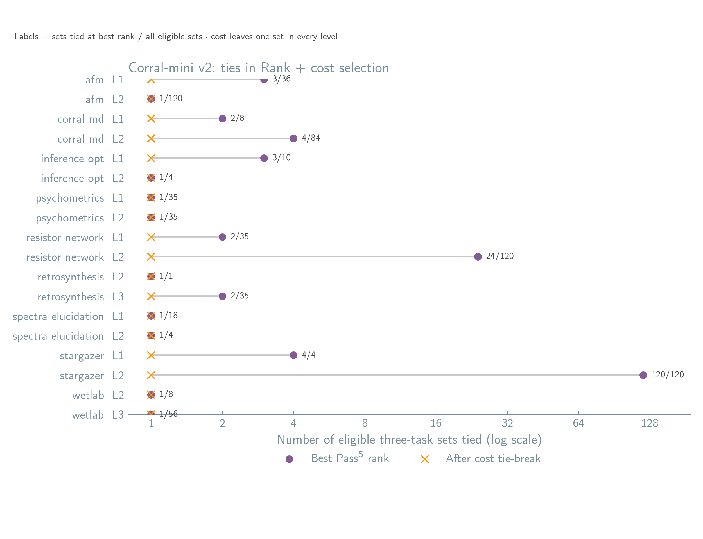
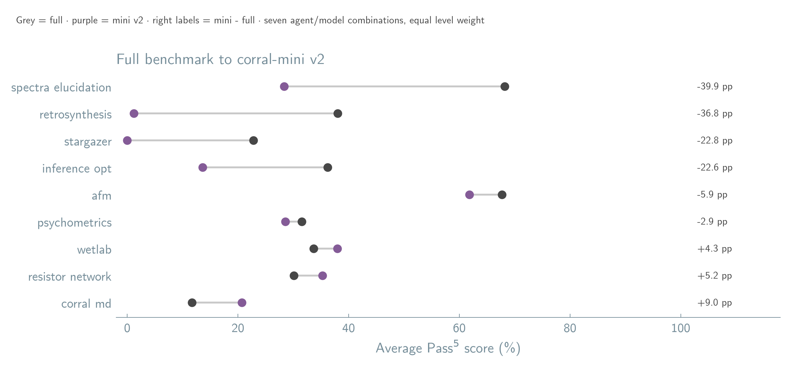
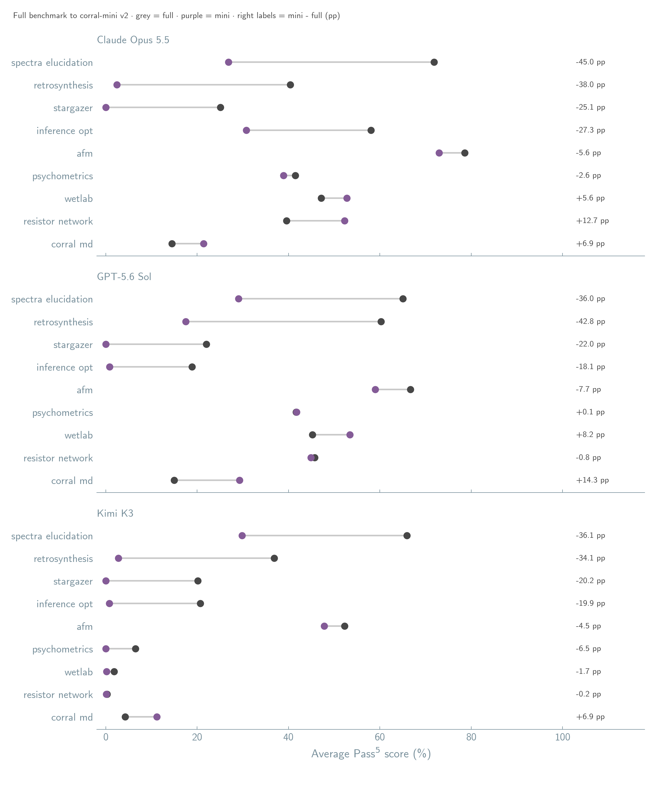
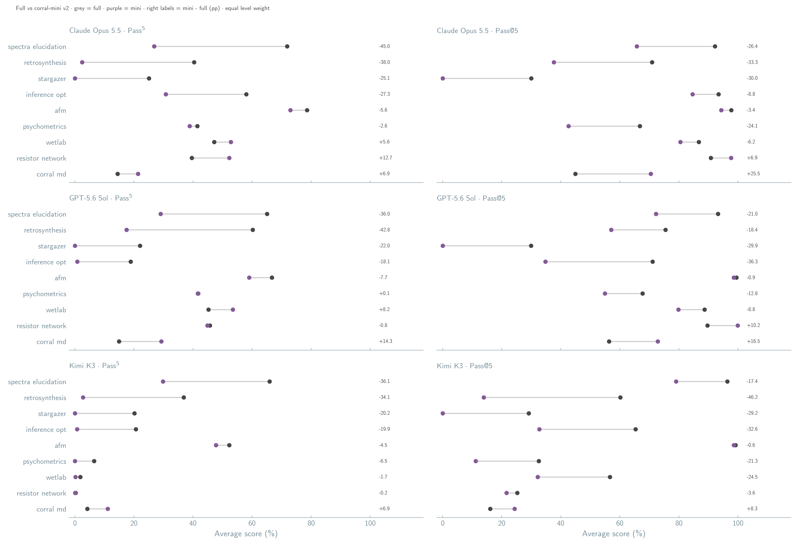
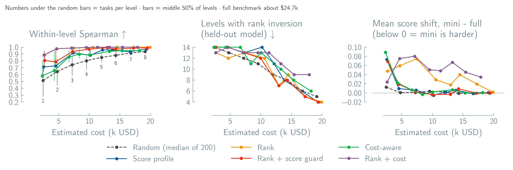
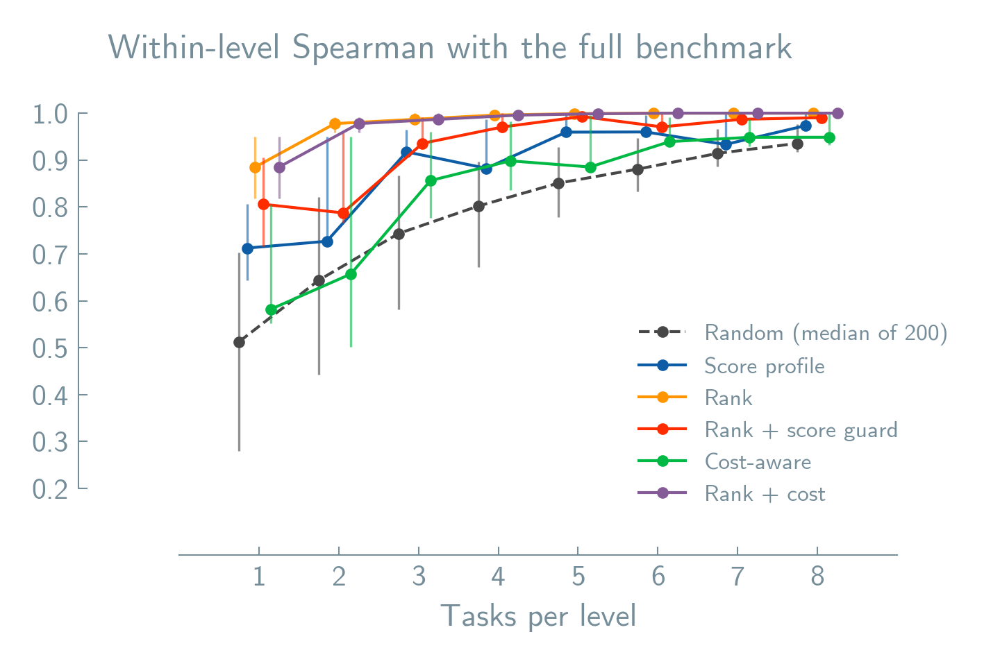
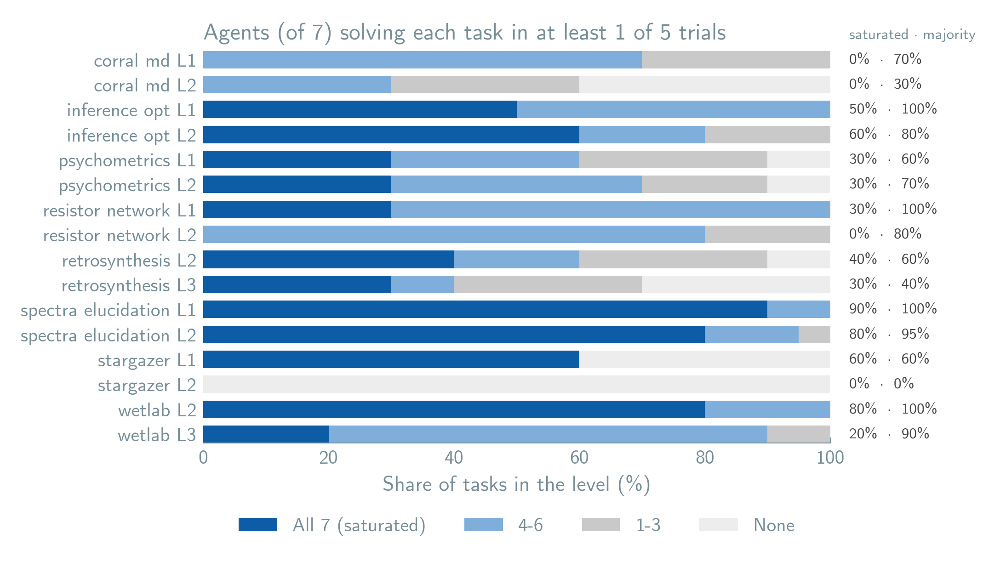
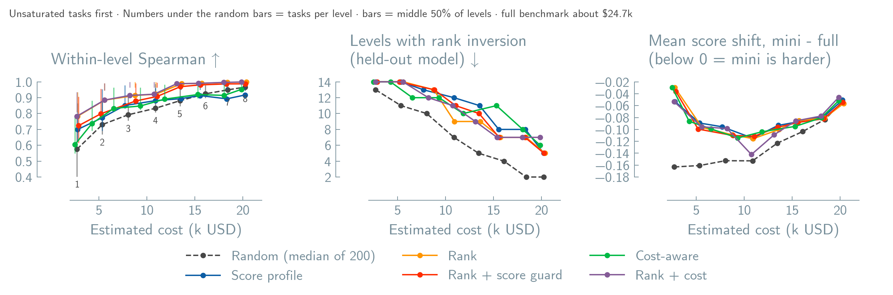
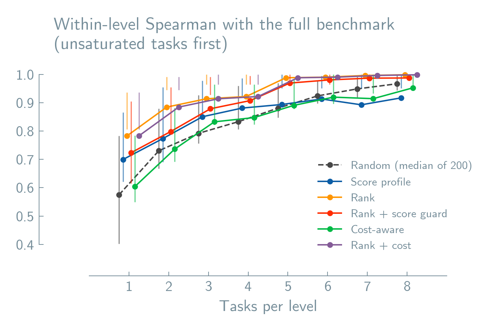
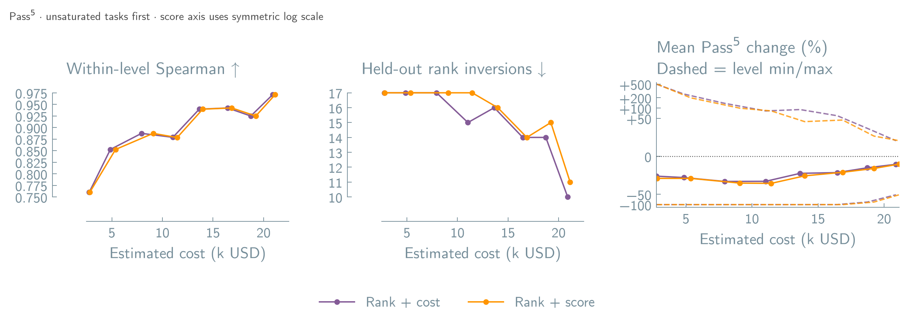

# Corral mini

A small, reproducible subset of the Corral benchmark: the same number of
tasks, *k*, from each environment/level, chosen from the final reports.

**Released: corral-mini v2**, Rank + cost with Pass^5 and unsaturated tasks
first, k = 3, 54 tasks
([`corral_mini_v2.json`](../src/corral/subsets/corral_mini_v2.json)). All 18
levels use report-based selection; AFM uses its November 2026 reports, and
retrosynthesis uses its corrected October reports (see
[Retrosynthesis correction](#retrosynthesis-correction-2026-11-13)). The
original [v1 release](../src/corral/subsets/corral_mini_v1.json) remains
available by version. Levels without report data in other environments (e.g.
wetlab L1, retrosynthesis L1, samplemath) are not part of the mini.

## Run the mini

`corral bench` runs the latest mini (v2) by default. Run v1 only with
`--mini-version 1`. The level comes from
`--env-kwargs '{"level": N}'` as before.

```bash
corral bench --environment wetlab --env-kwargs '{"level": 2}' --agent tool-calling   # mini
corral bench ... --run-full          # every task of the level
corral bench ... --mini-version 1    # explicitly run v1
corral bench ... --task ID           # explicit tasks override both
corral bench ... --list-tasks        # show what would run
```

A level the mini does not cover runs in full with a warning. The run
metadata records the subset (`task_subset`), and mini run IDs contain
`tasks-mini-v<N>`, so mini and full results are not mixed up.

## Build a release

AFM's report source is recorded separately in the manifest (`afm_source`), as
are environments built from their reports in this repository with
`--local-reports ENVIRONMENT` (`local_sources`); the pinned Hugging Face source
describes the other environments. The build script refuses to overwrite
existing releases.

Pin the Hugging Face summary dataset by its full commit hash (v1 source:
`6d8dc71d6bcc3a3c6c76a28609f4f4a510ea2dd8`). Add `--tasks-parquet PATH` to
use a local copy of the `tasks` table.

```bash
# 1. Write a new release (defaults: rank_cost, Pass^5, unsaturated first, k = 3)
python scripts/build_corral_mini.py --revision <HASH> --version <N>

# 2. Compare all methods for k = 1..8 -> results.csv, saturation.csv
python scripts/compare_corral_mini.py --revision <HASH>
#    Same, preferring unsaturated tasks -> results_unsaturated.csv
python scripts/compare_corral_mini.py --revision <HASH> --exclude-saturated

# 3. Plot every results CSV present -> figures/ (*_unsaturated for that run)
uv run --no-project --with "lama-aesthetics @ git+https://github.com/lamalab-org/lama-aesthetics@f9aaa7e58b66cd4698ea59a6785c24a841221dd2" \
  python scripts/plot_corral_mini.py
```

## Retrosynthesis correction (2026-11-13)

The October retrosynthesis reports contained trials that ran against reaction
database v1, whose only template for `make_1` had the wrong product, and against
the old buyables and budgets. `make_1`, `make_5`, `make_6`, `make_7` and
`make_8` were rerun at both levels (351 trials; aggregate passes 315 -> 397/700;
see [`reports/retrosynthesis/README.md`](../reports/retrosynthesis/README.md)).
The v2 retrosynthesis levels were reselected from these corrected reports with
the same method; all other environments keep their v2 tasks.

| Level | Before | After |
|---|---|---|
| 2 | `make_1`, `make_6`, `make_10` | `make_6`, `make_9`, `make_10` |
| 3 | `make_1`, `make_5`, `make_6` | `make_6`, `make_7`, `make_8` |

`make_1` is now solved by most agents, so it no longer counts as unsaturated.
The manifest records the reports under `local_sources`. Reproduce it with:

```bash
python scripts/build_corral_mini.py --version 2 --output PATH \
  --revision 6d8dc71d6bcc3a3c6c76a28609f4f4a510ea2dd8 \
  --local-reports retrosynthesis
```

## Methods

**v2 selection.** In each level, choose three tasks. Prefer tasks that at least
one of the seven observed agents never solved in five trials. If fewer than
three such tasks exist, fill the remaining slots from saturated tasks. Among
eligible three-task sets, maximize Spearman correlation between the agents'
mean Pass^5 scores on the set and on the full level. If several sets share the
best correlation, choose the one with the lowest estimated cost across the
seven agents and five trials. If costs also tie, minimize mean squared Pass^5
score error, then use seed 0 to break any remaining tie. Spearman, cost, and
score error are rounded to nine decimals before comparing ties.

The [tie audit](rank_cost_pass_hat_5_ties.csv) gives, for every environment and
level, the number of eligible sets, the number tied at the best rank, and the
number still tied after cost and score error. Cost resolves every best-rank
tie in v2; no random tie break was needed. For example, all 120 three-task
sets in stargazer L2 tie on Pass^5 ranking because every agent scores zero;
cost picks one of them.



Regenerate the tie plot with `python scripts/plot_corral_mini_ties.py` in an
environment with `lama-aesthetics` installed.



The [environment score table](v2_pass_hat_5_by_environment.csv) averages
Pass^5 across the seven agent/model combinations and gives each reported level
equal weight. The plot shows full and mini scores; labels at the right show
mini minus full in percentage points. It can be regenerated with
`python scripts/plot_corral_mini_v2_scores.py --tasks-parquet PATH`.



The [model score table](v2_pass_hat_5_by_model_environment.csv) separates the
three observed models. Each subplot averages that model's agents within each
level, then gives the environment's reported levels equal weight.



The [combined metric table](v2_pass_metrics_by_model_environment.csv) adds
Pass@5 to the same full-versus-mini comparison. In the six-panel figure, rows
separate the three models and columns show Pass^5 and Pass@5. Both metrics use
the observed five-trial success rate per task: Pass^5 is `(c/5)^5`, while
Pass@5 is `1 - (1 - c/5)^5`. Right labels are mini minus full in percentage
points. Regenerate it with
`python scripts/plot_corral_mini_v2_metrics.py --tasks-parquet PATH`.

The method comparison below describes the original Pass@5 analysis used for
v1. The [Pass^5 comparison](#pass5-comparison) describes the v2 criterion.

Each method runs separately in every environment/level. Apart from random,
each one tries every possible *k*-task combination. Combinations that tie on
every criterion are ordered by a seeded random permutation, so task IDs never
decide the pick (for v1 no level needed it). "Score" means an agent's mean Pass@5 on the
chosen tasks, and the target is the same agent's score on all tasks of that
level.

| Method | Picks the combination that… | Catch |
|---|---|---|
| **Random** | Is drawn uniformly. Results are the median of 200 seeded draws. | Baseline. A single draw can be much worse than the median. |
| **Score profile** | Has the smallest mean squared error between mini and full agent scores. | Keeps scores close but not the ordering. Dips at k = 4 and 7 instead of improving steadily. |
| **Rank** | Has the highest Spearman correlation between mini and full agent ranking. Ties go to the lower score error. | Overfits the ranking: one agent's level score can be off by 0.4 at k = 4. |
| **Rank + score guard** | Has the highest Spearman among combinations that pass the **score guard**. | Ranking ends up slightly below Rank. |
| **Cost-aware** | Is cheapest among combinations that pass the **score guard**. | Ranking quality changes unpredictably with *k*. |
| **Rank + cost** | Has the highest Spearman. Ties go to the cheapest. | Same ranking as Rank for less money, but generalizes worse to a held-out model. Ignores score error. |

**Score guard:** a combination passes when its worst per-agent score error is
within **0.02** of the smallest worst-case error any combination in that level
can achieve.

**Cost:** each task's estimated USD is summed over the 7 observed agents ×
5 trials. Tokens are priced at the 2026-10-27 list prices in
[`prices.json`](prices.json), with no cache discounts. Running the full
benchmark this way is about $24.7k. The cost of a future run depends on that
run's models.

## How methods are scored

All metrics use the 7 agent/model combinations that ran every task.

- **Ranking kept**: Spearman correlation between mini and full agent ranking,
  computed within each level and averaged over the 15 informative levels.
  Stargazer level 2 is left out because every agent scores 0 there.
- **Ordering loss**: two agents at least **5 points** apart in Pass@5 on the
  full level are tied or reversed on the mini. *Levels with a loss* counts
  levels with at least one such pair.
- **Held-out model**: hide one model (every agent using it), select tasks
  using only the other agents, and check whether pairs involving the hidden
  agents keep their order. This is repeated for each of the 3 models. It
  stands in for "a new model arrives", and it is the fairest test for methods
  fitted to the agents in the reports.
- **Worst level score error**: the largest absolute gap between mini and full
  Pass@5 for any agent in any level.
- **Mean score shift**: mini minus full Pass@5, averaged over every agent and
  level. Below 0 means the mini is harder. Errors in opposite directions
  cancel, so a shift near 0 does not mean every score is accurate.

## Results





Ranking points are the mean over the 15 informative levels. The vertical bar
on each point spans the 25th–75th percentile of those levels, so a long bar
means the method keeps the ranking in some levels and loses it in others. On
the task-count plot, methods are shifted slightly sideways so bars do not
overlap. On the score-shift panel, methods fitted to scores sit at 0. The
rank methods make the mini slightly easier, Rank + cost the most (about
+0.05), because cheap tasks tend to be easy. All numbers are in
[`results.csv`](results.csv).

| k (tasks) | Method | Ranking kept | Levels with a loss | …held-out model | Worst score error | USD |
|---|---|---:|---:|---:|---:|---:|
| 3 (48) | Random | 0.74 | 12 | **12** | 0.50 | 7.2k |
| | Score profile | 0.92 | 7 | 13 | **0.17** | 7.4k |
| | Rank | **0.99** | **3** | 13 | 0.68 | 7.4k |
| | Rank + score guard | 0.94 | 7 | 13 | **0.17** | 7.2k |
| | Cost-aware | 0.86 | 10 | 14 | **0.17** | **6.7k** |
| | Rank + cost (v1) | **0.99** | **3** | 13 | 0.68 | 7.1k |
| 4 (64) | Random | 0.80 | 11 | **11** | 0.42 | 9.5k |
| | Score profile | 0.88 | 5 | 14 | 0.13 | 10.2k |
| | Rank | **1.00** | **1** | 12 | 0.40 | 10.6k |
| | Rank + score guard | 0.97 | 5 | 12 | **0.12** | 10.0k |
| | Cost-aware | 0.90 | 7 | **11** | 0.13 | **8.4k** |
| | Rank + cost | **1.00** | **1** | 13 | 0.42 | 9.5k |
| 5 (80) | Random | 0.85 | 9 | 9 | 0.33 | 12.0k |
| | Score profile | 0.96 | 3 | 11 | **0.10** | 12.2k |
| | Rank | **1.00** | **0** | **7** | 0.20 | 13.0k |
| | Rank + score guard | 0.99 | 1 | **7** | **0.10** | 12.9k |
| | Cost-aware | 0.89 | 8 | 13 | 0.11 | **10.0k** |
| | Rank + cost | **1.00** | **0** | 13 | 0.42 | 11.3k |

**Why v1 is Rank + cost at k = 3.** It keeps the within-level ranking as well
as Rank (0.99) at the lowest cost of the rank methods, about $7.1k for the
observed agents, 29% of the full benchmark. The price is score accuracy: the
mini is about 0.08 Pass@5 easier on average, one agent's level score is off
by 0.68, and a new model loses an ordering in 13 of 15 levels. Use the mini
to compare agents, not to report full-benchmark scores.

## Caveats

- **The numbers are in-sample.** Every method except random is fitted to the
  same 7 agents it is scored on. Use the held-out-model column to judge how a
  method generalizes. Even at k = 5, every method loses an ordering for a new
  model in 7 or more of the 15 levels. The mini is better suited to overall
  rankings than to per-level ones.
- **Ranking and score accuracy trade off.** Rank alone distorts scores, and
  score profile alone gives a weaker ranking. The score guard is a compromise
  between the two.
- **Small *k* is coarse.** With 4 tasks, a level score can only move in steps
  of 0.25 Pass@5, so ties are common, and a tie counts as an ordering loss.
- Every level gets equal weight, so spectra elucidation's 20-task pool does
  not dominate. Most levels have only 10 tasks, so k = 8 already covers 80% of
  them.
- Optimizing pairwise ordering instead of Spearman was tested and dropped; it
  made no meaningful difference.

## Task saturation



An agent counts as solving a task if it passes in at least 1 of its 5 trials.
A task is **saturated** when all 7 agents solve it. **Majority** is 4 or more
agents, saturated tasks included. The counts are in
[`saturation.csv`](saturation.csv). 77 of 180 tasks are saturated.
Spectra elucidation (80–90%) and wetlab L2 (80%) are mostly saturated, while
stargazer L2 has no task any agent solves.

Saturated tasks still carry a little signal. Pass@5 here is estimated from
the pass rate (1 pass in 5 trials gives 0.67, 5 in 5 gives 1.0), so in 48 of
the 77 saturated tasks, agents' Pass@5 still differ.

## Unsaturated tasks first

The same six methods, but each level picks only from its unsaturated tasks
(as defined above). A level with fewer than k unsaturated tasks takes all of
them and fills the remaining slots with saturated tasks, chosen by the same
method. This affects spectra elucidation L1 and wetlab L2 (2 unsaturated
tasks each), and inference L2, spectra elucidation L2 and stargazer L1 (4
each). In the held-out-model check, saturation is judged only on the agents
used for selection. Results are still compared against the **full** level.





All tasks → unsaturated tasks first. Numbers are in
[`results_unsaturated.csv`](results_unsaturated.csv).

| k | Method | Spearman | Rank inversion, held-out model | Max. abs. error | Saturated tasks used | USD |
|---|---|---:|---:|---:|---:|---:|
| 3 | Random | 0.74 → 0.79 | 12 → **10** | 0.50 → 0.80 | 18 → 2 | 7.2k → 8.0k |
| | Score profile | 0.92 → 0.85 | 13 → 13 | 0.17 → 0.80 | 20 → 2 | 7.4k → 7.7k |
| | Rank | 0.99 → 0.91 | 13 → 13 | 0.68 → 0.80 | 18 → 2 | 7.4k → 8.8k |
| | Rank + score guard | 0.94 → 0.88 | 13 → 13 | 0.17 → 0.80 | 19 → 2 | 7.2k → 8.8k |
| | Cost-aware | 0.86 → 0.83 | 14 → 12 | 0.17 → 0.80 | 20 → 2 | 6.7k → 6.6k |
| | Rank + cost | 0.99 → 0.91 | 13 → 12 | 0.68 → 0.80 | 19 → 2 | 7.1k → 8.2k |
| 4 | Random | 0.80 → 0.83 | 11 → **7** | 0.42 → 0.80 | 24 → 4 | 9.5k → 10.9k |
| | Score profile | 0.88 → 0.88 | 14 → 12 | 0.13 → 0.80 | 23 → 4 | 10.2k → 10.9k |
| | Rank | 1.00 → 0.92 | 12 → 9 | 0.40 → 0.80 | 23 → 4 | 10.6k → 10.9k |
| | Rank + score guard | 0.97 → 0.91 | 12 → 11 | 0.12 → 0.80 | 22 → 4 | 10.0k → 11.1k |
| | Cost-aware | 0.90 → 0.85 | 11 → 12 | 0.13 → 0.80 | 23 → 4 | 8.4k → 9.3k |
| | Rank + cost | 1.00 → 0.92 | 13 → 11 | 0.42 → 0.80 | 26 → 4 | 9.5k → 10.8k |
| 5 | Random | 0.85 → 0.88 | 9 → **5** | 0.33 → 0.60 | 30 → 9 | 12.0k → 13.4k |
| | Score profile | 0.96 → 0.89 | 11 → 11 | 0.10 → 0.60 | 31 → 9 | 12.2k → 13.5k |
| | Rank | 1.00 → 0.99 | 7 → 9 | 0.20 → 0.60 | 28 → 9 | 13.0k → 13.6k |
| | Rank + score guard | 0.99 → 0.97 | 7 → 10 | 0.10 → 0.60 | 30 → 9 | 12.9k → 13.5k |
| | Cost-aware | 0.89 → 0.89 | 13 → 10 | 0.11 → 0.60 | 31 → 9 | 10.0k → 11.8k |
| | Rank + cost | 1.00 → 0.99 | 13 → 9 | 0.42 → 0.60 | 31 → 9 | 11.3k → 13.1k |

What changes:

- **Random gains the most.** Its held-out rank inversions drop from 11 to 7
  levels at k = 4, and from 9 to 5 at k = 5, the best of any method in either
  run. Unsaturated tasks are informative, so any draw from them works well,
  and random cannot overfit the 7 agents the way the fitted methods do.
- **Fitted methods lose in-sample ranking but gain little on held-out
  models.** With fewer candidate tasks, Rank drops from 1.00 to 0.92 at
  k = 4. Its held-out result improves (12 → 9), but most other methods move
  by only 0 to 2 levels, and at k = 5 Rank and Rank + score guard get worse
  (7 → 9 and 7 → 10).
- **The mini is harder for every method.** Scores shift down by 0.1–0.15 on
  average at k = 4–5, compared with about 0 for the fitted methods on all
  tasks. The worst cases come from short levels
  that must use their few hard tasks: spectra elucidation L2 at k = 4 puts one
  agent 0.80 below its full score. Treat these as harder subsets, not as
  estimates of the full score.
- **It usually costs more,** up to about 20%, because unsaturated tasks run
  longer.

## Pass^5 comparison

The following figure compares unsaturated-first **Rank + cost** and **Rank +
score** using task Pass^5 instead of Pass@5 for selection and evaluation. Pass^5
is `(successful trials / 5)^5` for each agent and task. AFM uses the November
reports and retrosynthesis its corrected October reports, both recorded in the
v2 manifest; the other environments use the pinned October summary table. The Rank + cost point at k = 3 is the v2 selection.



The first panel shows mean within-level Spearman. The second counts levels
where at least one pair involving a held-out model, separated by 0.05 Pass^5
on the full level, ties or
reverses on the subset. The third compares the average mini score with the
average full score as a percentage; dashed lines show the smallest and largest
percentage change in a level's average score. Stargazer L2 has zero full score,
so its percentage change is undefined and omitted from that panel. The score
panel uses a symmetric log scale to show both the mean and large positive
outliers. Values are in [`results_pass_hat_5_unsaturated.csv`](results_pass_hat_5_unsaturated.csv).

At three tasks per level, Rank + cost has Spearman 0.882, 17 held-out levels
with an inversion, and a −32.8% average score change. Rank + score has Spearman
0.882, 17 held-out levels with an inversion, and a −35.0% average score change.

To regenerate the figures from the pinned summary table:

```bash
uv run --no-project --with pandas --with pyarrow --with scipy --with numpy \
  --with "lama-aesthetics @ git+https://github.com/lamalab-org/lama-aesthetics@f9aaa7e58b66cd4698ea59a6785c24a841221dd2" \
  python scripts/plot_corral_mini_pass_hat_5.py --tasks-parquet PATH
```
