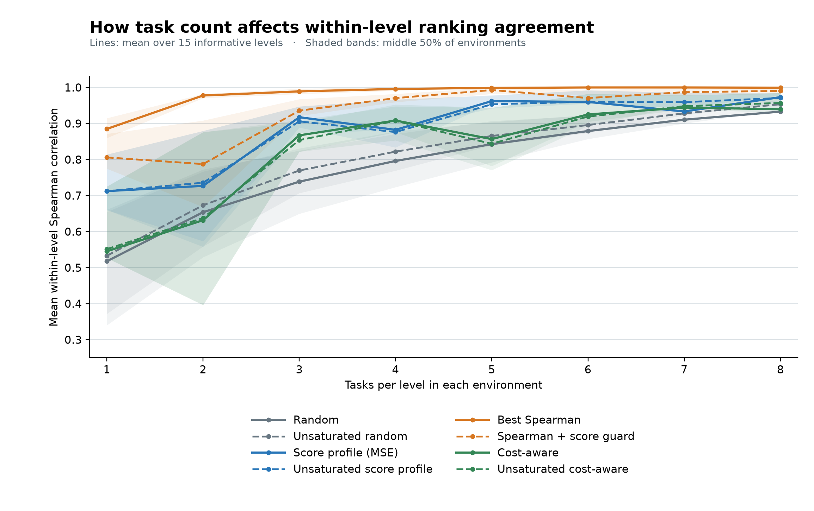

# Corral mini

`corral-mini` is a reproducible selection of task IDs from the final Corral
benchmark reports. The current manifest is a **score-profile baseline** while
alternative sampling methods are compared. AFM is excluded from the mini.

## Build or refresh

Run this after publishing the final reports to the Hugging Face summary
dataset. Supply the **full commit hash** of the summary dataset so a later
refresh does not silently change the source data:

```bash
python scripts/build_corral_mini.py --revision <40-character-HF-commit>
```

The script downloads the `tasks` configuration from
`jablonkagroup/corral-reports-october-runs-summary-v1` and writes
[`manifest.json`](manifest.json) and [`assessment.json`](assessment.json).
For an already downloaded table, add `--tasks-parquet PATH`; the script still
records its SHA-256 and the supplied source revision. Re-run with a new
revision when reports change, then review the manifest diff.

Compare methods at the same number of tasks per stratum:

```bash
python scripts/compare_corral_mini.py --revision <40-character-HF-commit>
```

This writes [`comparison.json`](comparison.json). Both scripts use the pinned
`tasks` table. The comparison uses the fixed historical USD prices in
[`prices.json`](prices.json).

Generate the task-count sweep and figure with:

```bash
python scripts/sweep_corral_mini.py --revision <40-character-HF-commit>
uv run --no-project --with matplotlib python scripts/plot_corral_mini_sweep.py
```

## Selection protocol

1. Exclude AFM, then treat every remaining `(environment, level)` as a stratum
   and require the **same number of tasks in all strata**. There are 16 strata.
2. For each candidate count `k`, select the exact `k`-task combination within
   each stratum whose agent Pass@5 profile has the smallest mean squared error
   relative to all tasks in that stratum. Lexicographic task order breaks ties.
   This is exhaustive, deterministic selection; no task IDs are handpicked.
3. Use the seven agent/model combinations observed in all 16 strata for
   ranking checks.
4. For each `k`, compare the mini Pass@5 ranking with the full ranking. Repeat
   selection while withholding each subject in turn, then measure the held-out
   score error and whether any agent pair separated by at least five percentage
   points reverses order. Select the **smallest** `k` satisfying Spearman
   correlation ≥ 0.95, maximum held-out score error ≤ 0.05, and zero such
   reversals. These thresholds can be changed with CLI flags. The assessment
   also reports Pass@1 agreement.

The benchmark score for each subject is the mean of its task scores within
each stratum, then the mean across strata. This gives each environment and
level equal weight, including spectra elucidation's larger task pool.

## Current baseline manifest

Source: Hugging Face summary revision
`6d8dc71d6bcc3a3c6c76a28609f4f4a510ea2dd8` (6,500 final trials,
1,300 task-by-subject rows).

| Tasks per stratum | Total tasks | Pass@5 rank correlation | Maximum held-out score error | Meets criteria |
|---:|---:|---:|---:|:---:|
| 1 | 16 | 0.964 | 0.087 | No |
| 2 | 32 | 0.857 | 0.072 | No |
| 3 | 48 | 1.000 | 0.061 | No |
| **4** | **64** | **0.964** | **0.025** | **Yes** |

The current 64-task manifest was selected by a **global** ranking check. It
preserves the order of agent pairs whose global Pass@5 scores differ by at
least five percentage points in the leave-one-subject-out check. Pass@1 rank
correlation is 0.964. The validation measures
agreement with the observed agents; it does not guarantee rankings of future
models. Small score gaps among existing agents can reverse in a mini run. A
single agent's Pass@5 score in one environment/level can differ by as much as
13.4 percentage points. The selection targets the overall ranking; estimates
within individual strata can be less precise.

## Sampler choices and within-level comparison



The line is the mean within-level Spearman correlation with the full reports.
The shaded band is the 25th–75th percentile of environment averages across
the eight included environments. Random lines average 200 seeded samples at
each task count. The plotted values are in [`sweep.csv`](sweep.csv), with
environment values in [`sweep_environments.json`](sweep_environments.json).
Ranking selectors are optimized on the historical agents, so their plotted
agreement is an in-sample result. The held-out-model checks below assess how
well the choices transfer to agents whose model was absent during selection.

All methods below select four tasks from each of the same 16 strata. “Random”
rows summarize 500 seeded draws; the other rows are deterministic. A task is
called **saturated** when every observed agent solved it at least once in five
trials, so every agent has Pass@5 = 1. Fifteen of the 180 eligible tasks are
saturated. “Unsaturated” methods exclude those tasks.

| Method | Mean level rank correlation | Levels with a material ordering loss | Worst level score error | Estimated USD |
|---|---:|---:|---:|---:|
| Random, median | 0.804 | 11 | 0.405 | $9,595 |
| Unsaturated random, median | 0.825 | 11 | 0.405 | $9,823 |
| Score profile (current manifest) | 0.882 | 5 | 0.134 | $10,024 |
| Unsaturated score profile | 0.876 | 5 | 0.134 | $10,156 |
| Pairwise ranking | 0.994 | 0 | 0.400 | $10,233 |
| Pairwise ranking with score guard | 0.967 | 5 | 0.117 | $9,761 |
| Best Spearman | 0.996 | 1 | 0.400 | $10,738 |
| Spearman with score guard | 0.970 | 5 | 0.120 | $10,121 |
| Cheapest tasks | 0.670 | 14 | 0.588 | $6,589 |
| Cost-aware, 0.02 profile tolerance | 0.908 | 8 | 0.148 | $7,989 |
| Unsaturated cost-aware, 0.02 tolerance | 0.907 | 9 | 0.148 | $8,046 |

Level ranking compares the seven agents **within each environment and level**.
One level, stargazer level 2, has zero Pass@5 for every agent and provides no
ranking signal. The correlation averages the other 15 levels. A material
ordering loss means a pair separated by at least five percentage points in
the full level ties or reverses in the mini level. Lower counts are better.
The worst level score error is the largest absolute change for one agent in
one level. The ranking samplers illustrate why rank agreement and score
agreement need to be checked together. When an entire model is withheld at
four tasks per stratum, the score-profile baseline has a material ordering
loss in 14 of the 15 informative levels.

Five tasks per stratum (80 tasks total) improve several methods. The table
below also shows how many levels have a material ordering loss when an entire
model is withheld during selection, then evaluated on the selected tasks.
That check is stricter than comparing the agents used to choose tasks.

| Method at five tasks per stratum | Mean level rank correlation | Levels with an ordering loss | Levels with a loss for a held-out model | Worst level score error | Estimated USD |
|---|---:|---:|---:|---:|---:|
| Score profile | 0.962 | 5 | 11 | 0.100 | $11,747 |
| Unsaturated score profile | 0.953 | 4 | 9 | 0.100 | $11,850 |
| Pairwise ranking | 0.997 | 0 | 10 | 0.200 | $12,692 |
| Unsaturated pairwise ranking | 0.997 | 0 | 8 | 0.200 | $12,700 |
| Best Spearman | 0.999 | 0 | 9 | 0.200 | $12,819 |
| Unsaturated best Spearman | 0.999 | 0 | 8 | 0.200 | $12,819 |
| Pairwise ranking with score guard | 0.990 | 1 | 10 | 0.100 | $12,540 |
| Spearman with score guard | 0.993 | 1 | 9 | 0.100 | $12,778 |
| Cost-aware, 0.02 profile tolerance | 0.857 | 9 | 12 | 0.133 | $10,004 |

The complete five-task comparison is in
[`comparison_k5.json`](comparison_k5.json). Even methods with perfect ordering
on the observed agents have ordering losses when a model is withheld. That
limits how confidently these reports can establish rankings for future models.

The cost-aware method picks the cheapest combination in each stratum whose
Pass@5 profile root-mean-square error is within 0.02 of that stratum's best
profile match. The estimated USD total replays the observed seven agent/model
combinations with five trials per task, using 2026-10-27 list prices without
cache discounts. It is a comparison of historical task cost; the price and
token mix for future models may differ. The rank-with-score-guard methods keep
each level's maximum score error within 0.02 of the best possible maximum for
that level, then optimize either pairwise order or Spearman correlation.
The full comparison includes
per-level rankings, random-sample ranges, and checks with each agent or whole
model withheld during selection. These checks show how much the choices depend
on the agents already in the reports. The protocol has **not yet been chosen**;
`manifest.json` remains the score-profile baseline for comparison.

The `tasks_by_environment` mapping in `manifest.json` supplies task IDs for
each environment and level. Corral's `bench --task TASK_ID` option accepts
repeated task IDs, so the manifest can be used without copying task files.
