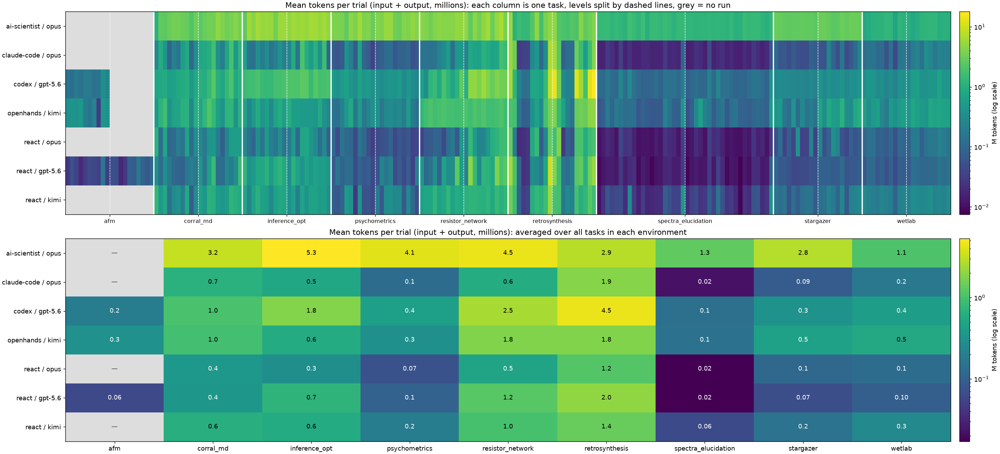
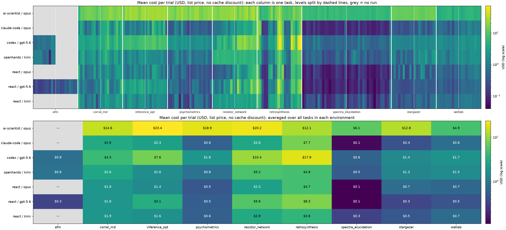

# Cost estimate

Estimated API cost of the 116 runs in `reports/<environment>/runs.csv`, by environment and by agent and model. Token counts come from the `input_tokens` and `output_tokens` columns of `runs.csv` on `report_audit` at `d2882940c` (2026-10-27).

**Summary:** about **$24.8k** at list price with no cache discount, which is an upper bound. If about 90% of input tokens were served from the prompt cache, the cost is closer to **$6.4k**.

## Prices

USD per 1M tokens, looked up on 2026-10-27.

| Model | Input | Output | Cache read |
|---|---:|---:|---:|
| claude-opus-5-5 | $4.00 | $20.00 | $0.20 |
| gpt-5.6-sol | $4.00 | $20.00 | $0.40 (assumed) |
| kimi-k3 (OpenRouter) | $2.60 | $13.00 | $0.29 |

- GPT-5.6 Sol was cut from $5 / $30 in September 2026. The runs were made in October 2026, so this uses the lower price.
- Kimi K3 is listed at $3 / $15 on Moonshot's API and on some OpenRouter providers. Those rates would raise the Kimi rows by about 15%.
- I couldn't find a cache-read price for GPT-5.6 Sol. $0.40 assumes cached input costs 10% of the normal input price.

## Upper bound: list price, no cache discount

| Agent / model | afm | corral_md | inference_opt | psychometrics | resistor_network | retrosynthesis | spectra_elucidation | stargazer | wetlab | **Total** |
|---|---:|---:|---:|---:|---:|---:|---:|---:|---:|---:|
| ai-scientist / claude-opus-5-5 | — | $1,455 | $2,337 | $1,894 | $2,023 | $1,207 | $1,217 | $1,282 | $488 | **$11,903** |
| claude-code / claude-opus-5-5 | — | $290 | $233 | $59 | $262 | $772 | $25 | $43 | $76 | **$1,760** |
| codex / gpt-5.6-sol | $39 | $428 | $760 | $183 | $1,044 | $1,795 | $120 | $137 | $173 | **$4,678** |
| openhands / kimi-k3 | $42 | $259 | $157 | $85 | $517 | $477 | $105 | $125 | $147 | **$1,914** |
| react / claude-opus-5-5 | — | $181 | $142 | $48 | $229 | $471 | $22 | $75 | $66 | **$1,233** |
| react / gpt-5.6-sol | $33 | $182 | $308 | $54 | $563 | $828 | $22 | $34 | $46 | **$2,070** |
| react / kimi-k3 | — | $185 | $162 | $57 | $289 | $378 | $64 | $48 | $73 | **$1,255** |
| **Total** | **$114** | **$2,979** | **$4,099** | **$2,379** | **$4,927** | **$5,927** | **$1,576** | **$1,744** | **$1,068** | **$24,813** |

## Likely range: 90% of input tokens as cache reads

| Agent / model | afm | corral_md | inference_opt | psychometrics | resistor_network | retrosynthesis | spectra_elucidation | stargazer | wetlab | **Total** |
|---|---:|---:|---:|---:|---:|---:|---:|---:|---:|---:|
| ai-scientist / claude-opus-5-5 | — | $408 | $572 | $535 | $550 | $230 | $364 | $356 | $133 | **$3,147** |
| claude-code / claude-opus-5-5 | — | $68 | $52 | $17 | $64 | $143 | $11 | $13 | $21 | **$388** |
| codex / gpt-5.6-sol | $9 | $98 | $168 | $45 | $239 | $355 | $31 | $34 | $38 | **$1,015** |
| openhands / kimi-k3 | $10 | $63 | $38 | $23 | $156 | $104 | $50 | $32 | $36 | **$510** |
| react / claude-opus-5-5 | — | $63 | $45 | $27 | $68 | $81 | $12 | $40 | $24 | **$361** |
| react / gpt-5.6-sol | $15 | $74 | $80 | $23 | $194 | $170 | $13 | $14 | $16 | **$599** |
| react / kimi-k3 | — | $55 | $44 | $19 | $89 | $86 | $44 | $18 | $21 | **$376** |
| **Total** | **$34** | **$829** | **$999** | **$687** | **$1,359** | **$1,168** | **$525** | **$507** | **$289** | **$6,397** |

## Tokens

All runs together used 5.90B input tokens and 146M output tokens. Input tokens make up 83–97% of the list-price cost, so the cache hit rate matters most to the real cost.

| Agent / model | Input tokens | Output tokens | Input share of list cost |
|---|---:|---:|---:|
| ai-scientist / claude-opus-5-5 | 2,560M | 83.1M | 86% |
| claude-code / claude-opus-5-5 | 401M | 7.8M | 91% |
| codex / gpt-5.6-sol | 1,130M | 7.8M | 97% |
| openhands / kimi-k3 | 675M | 12.2M | 92% |
| react / claude-opus-5-5 | 255M | 10.7M | 83% |
| react / gpt-5.6-sol | 454M | 12.7M | 88% |
| react / kimi-k3 | 423M | 12.0M | 88% |

## Observations

- **ai-scientist is about half of the total.** It used 2.56B input tokens, around 200M per environment, and is not the top scorer in any environment.
- **codex is the second most expensive.** Its 1.13B input tokens went mostly to retrosynthesis and resistor_network.
- **retrosynthesis and resistor_network cost the most** of the environments. afm is cheap only because three of its agent and model pairs have no runs.

## Heatmaps

Mean tokens (input + output) and mean list-price cost per trial. In each figure, the top panel has one column per task, grouped by environment, with dashed lines between levels. The bottom panel averages each environment. Grey means no run. The colour scales are logarithmic.

## Average cost per trial

Cost of one attempt at one task, averaged over every trial of that environment's tasks at both levels. Each cell is list price / 90% cache estimate.

| Agent / model | afm | corral_md | inference_opt | psychometrics | resistor_network | retrosynthesis | spectra_elucidation | stargazer | wetlab | **All** |
|---|---:|---:|---:|---:|---:|---:|---:|---:|---:|---:|
| ai-scientist / opus | — | $15 / $4.08 | $23 / $5.72 | $19 / $5.35 | $20 / $5.50 | $12 / $2.30 | $6.08 / $1.82 | $13 / $3.56 | $4.88 / $1.33 | **$13 / $3.50** |
| claude-code / opus | — | $2.90 / $0.68 | $2.33 / $0.52 | $0.59 / $0.17 | $2.62 / $0.64 | $7.72 / $1.43 | $0.12 / $0.05 | $0.43 / $0.13 | $0.76 / $0.21 | **$1.96 / $0.43** |
| codex / gpt-5.6 | $0.78 / $0.17 | $4.28 / $0.98 | $7.60 / $1.68 | $1.83 / $0.45 | $10 / $2.39 | $18 / $3.55 | $0.60 / $0.15 | $1.37 / $0.34 | $1.73 / $0.38 | **$4.92 / $1.07** |
| openhands / kimi | $0.84 / $0.19 | $2.59 / $0.63 | $1.57 / $0.38 | $0.85 / $0.23 | $5.17 / $1.56 | $4.77 / $1.04 | $0.53 / $0.25 | $1.25 / $0.32 | $1.47 / $0.36 | **$2.01 / $0.54** |
| react / opus | — | $1.81 / $0.63 | $1.42 / $0.45 | $0.48 / $0.27 | $2.29 / $0.68 | $4.71 / $0.81 | $0.11 / $0.06 | $0.75 / $0.40 | $0.66 / $0.24 | **$1.37 / $0.40** |
| react / gpt-5.6 | $0.33 / $0.15 | $1.82 / $0.74 | $3.08 / $0.80 | $0.54 / $0.23 | $5.63 / $1.94 | $8.28 / $1.70 | $0.11 / $0.06 | $0.34 / $0.14 | $0.46 / $0.16 | **$2.07 / $0.60** |
| react / kimi | — | $1.85 / $0.55 | $1.62 / $0.44 | $0.57 / $0.19 | $2.89 / $0.89 | $3.78 / $0.86 | $0.32 / $0.22 | $0.48 / $0.18 | $0.73 / $0.21 | **$1.39 / $0.42** |
| **All agents** | **$0.57 / $0.17** | **$4.26 / $1.18** | **$5.86 / $1.43** | **$3.40 / $0.98** | **$7.04 / $1.94** | **$8.47 / $1.67** | **$1.13 / $0.37** | **$2.49 / $0.72** | **$1.53 / $0.41** | **$3.82 / $0.98** |

## Most expensive tasks

The 15 tasks with the highest list-price cost per trial, averaged over all agents.

| Environment | Level | Task | Cost per trial | Mean score |
|---|---:|---|---:|---:|
| retrosynthesis | 2 | `make_9_lvl2` | $22 | 0.03 |
| retrosynthesis | 3 | `make_9_lvl3` | $22 | 0.09 |
| retrosynthesis | 3 | `make_10_lvl3` | $21 | 0.00 |
| retrosynthesis | 2 | `make_10_lvl2` | $17 | 0.11 |
| retrosynthesis | 3 | `make_8_lvl3` | $16 | 0.00 |
| retrosynthesis | 3 | `make_5_lvl3` | $14 | 0.06 |
| retrosynthesis | 3 | `make_6_lvl3` | $11 | 0.00 |
| resistor_network | 2 | `task_7` | $11 | 0.49 |
| resistor_network | 2 | `task_8` | $11 | 0.20 |
| resistor_network | 2 | `task_1` | $10 | 0.46 |
| resistor_network | 2 | `task_4` | $9.57 | 0.37 |
| retrosynthesis | 3 | `make_1_lvl3` | $9.49 | 0.03 |
| resistor_network | 2 | `task_5` | $9.09 | 0.60 |
| resistor_network | 2 | `task_9` | $9.04 | 0.31 |
| resistor_network | 2 | `task_2` | $9.03 | 0.57 |

## Cost per trial for each task

List price, averaged over the trials of each task (5 per agent). Multiply by about 0.25 for the 90% cache estimate. The last columns average over all agents.

afm: 20 tasks

| Level | Task | ai-scientist / opus | claude-code / opus | codex / gpt-5.6 | openhands / kimi | react / opus | react / gpt-5.6 | react / kimi | **All agents** | Mean score |
|---:|---|---:|---:|---:|---:|---:|---:|---:|---:|---:|
| 1 | `afm_experiment_level_1_task_1` | — | — | $0.60 | $1.01 | — | $0.14 | — | **$0.58** | 0.13 |
| 1 | `afm_experiment_level_1_task_10` | — | — | $0.52 | $1.14 | — | $0.33 | — | **$0.66** | 0.60 |
| 1 | `afm_experiment_level_1_task_2` | — | — | $0.78 | $1.04 | — | $0.17 | — | **$0.66** | 0.60 |
| 1 | `afm_experiment_level_1_task_3` | — | — | $0.59 | $1.27 | — | $0.15 | — | **$0.67** | 0.33 |
| 1 | `afm_experiment_level_1_task_4` | — | — | $0.77 | $0.53 | — | $0.19 | — | **$0.50** | 0.20 |
| 1 | `afm_experiment_level_1_task_5` | — | — | $0.75 | $0.42 | — | $0.24 | — | **$0.47** | 0.13 |
| 1 | `afm_experiment_level_1_task_6` | — | — | $0.58 | $0.63 | — | $0.25 | — | **$0.49** | 0.47 |
| 1 | `afm_experiment_level_1_task_7` | — | — | $0.64 | $0.08 | — | $0.16 | — | **$0.29** | 0.67 |
| 1 | `afm_experiment_level_1_task_8` | — | — | $1.47 | $1.24 | — | $0.82 | — | **$1.18** | 0.33 |
| 1 | `afm_experiment_level_1_task_9` | — | — | $1.09 | $1.06 | — | $0.17 | — | **$0.77** | 0.67 |
| 2 | `afm_experiment_level_2_task_1` | — | — | — | — | — | $0.27 | — | **$0.27** | 0.20 |
| 2 | `afm_experiment_level_2_task_10` | — | — | — | — | — | $0.33 | — | **$0.33** | 0.60 |
| 2 | `afm_experiment_level_2_task_2` | — | — | — | — | — | $0.21 | — | **$0.21** | 0.20 |
| 2 | `afm_experiment_level_2_task_3` | — | — | — | — | — | $0.23 | — | **$0.23** | 0.00 |
| 2 | `afm_experiment_level_2_task_4` | — | — | — | — | — | $0.45 | — | **$0.45** | 0.00 |
| 2 | `afm_experiment_level_2_task_5` | — | — | — | — | — | $0.34 | — | **$0.34** | 0.20 |
| 2 | `afm_experiment_level_2_task_6` | — | — | — | — | — | $0.83 | — | **$0.83** | 0.80 |
| 2 | `afm_experiment_level_2_task_7` | — | — | — | — | — | $0.49 | — | **$0.49** | 0.60 |
| 2 | `afm_experiment_level_2_task_8` | — | — | — | — | — | $0.32 | — | **$0.32** | 0.40 |
| 2 | `afm_experiment_level_2_task_9` | — | — | — | — | — | $0.53 | — | **$0.53** | 1.00 |

corral_md: 20 tasks

| Level | Task | ai-scientist / opus | claude-code / opus | codex / gpt-5.6 | openhands / kimi | react / opus | react / gpt-5.6 | react / kimi | **All agents** | Mean score |
|---:|---|---:|---:|---:|---:|---:|---:|---:|---:|---:|
| 1 | `level_1_task_1` | $5.17 | $1.30 | $3.12 | $1.44 | $4.85 | $2.01 | $4.10 | **$3.14** | 0.11 |
| 1 | `level_1_task_10` | $12 | $4.00 | $3.36 | $3.13 | $0.68 | $0.56 | $1.45 | **$3.59** | 0.20 |
| 1 | `level_1_task_2` | $11 | $1.93 | $3.73 | $4.53 | $3.49 | $1.48 | $2.34 | **$4.13** | 0.46 |
| 1 | `level_1_task_3` | $14 | $0.42 | $2.51 | $1.10 | $0.49 | $0.88 | $0.39 | **$2.78** | 0.43 |
| 1 | `level_1_task_4` | $16 | $1.05 | $2.73 | $1.83 | $0.69 | $0.50 | $0.93 | **$3.38** | 0.06 |
| 1 | `level_1_task_5` | $16 | $0.72 | $3.51 | $1.92 | $1.01 | $0.45 | $1.16 | **$3.48** | 0.57 |
| 1 | `level_1_task_6` | $14 | $2.48 | $3.75 | $2.80 | $0.78 | $0.41 | $0.64 | **$3.58** | 0.54 |
| 1 | `level_1_task_7` | $13 | $3.64 | $4.07 | $3.03 | $3.30 | $0.82 | $2.42 | **$4.38** | 0.17 |
| 1 | `level_1_task_8` | $9.97 | $0.46 | $2.20 | $0.75 | $0.58 | $1.40 | $0.22 | **$2.22** | 0.66 |
| 1 | `level_1_task_9` | $15 | $1.59 | $3.53 | $2.68 | $1.74 | $0.77 | $0.94 | **$3.72** | 0.31 |
| 2 | `level_2_task_1` | $11 | $3.54 | $4.42 | $2.05 | $1.48 | $2.67 | $1.84 | **$3.88** | 0.00 |
| 2 | `level_2_task_10` | $14 | $3.70 | $3.86 | $3.37 | $0.93 | $0.73 | $1.34 | **$3.99** | 0.51 |
| 2 | `level_2_task_2` | $15 | $4.19 | $5.64 | $5.87 | $1.97 | $2.87 | $3.07 | **$5.57** | 0.51 |
| 2 | `level_2_task_3` | $16 | $7.39 | $9.74 | $3.66 | $2.64 | $6.55 | $2.80 | **$6.91** | 0.03 |
| 2 | `level_2_task_4` | $23 | $1.77 | $4.11 | $1.78 | $1.21 | $0.61 | $1.60 | **$4.80** | 0.00 |
| 2 | `level_2_task_5` | $18 | $0.96 | $3.17 | $1.18 | $0.69 | $0.56 | $1.35 | **$3.72** | 0.43 |
| 2 | `level_2_task_6` | $15 | $3.20 | $5.55 | $3.20 | $1.45 | $1.53 | $1.64 | **$4.50** | 0.00 |
| 2 | `level_2_task_7` | $17 | $7.97 | $8.22 | $3.33 | $2.71 | $0.93 | $3.43 | **$6.20** | 0.00 |
| 2 | `level_2_task_8` | $21 | $2.18 | $3.63 | $1.14 | $2.71 | $1.83 | $2.83 | **$5.00** | 0.03 |
| 2 | `level_2_task_9` | $16 | $5.47 | $4.66 | $3.05 | $2.75 | $8.80 | $2.57 | **$6.15** | 0.03 |

inference_opt: 20 tasks

| Level | Task | ai-scientist / opus | claude-code / opus | codex / gpt-5.6 | openhands / kimi | react / opus | react / gpt-5.6 | react / kimi | **All agents** | Mean score |
|---:|---|---:|---:|---:|---:|---:|---:|---:|---:|---:|
| 1 | `math_algebra_b` | $12 | $2.72 | $6.29 | $1.83 | $1.37 | $5.01 | $2.11 | **$4.44** | 0.63 |
| 1 | `math_algebra_d` | $26 | $0.68 | $6.70 | $0.72 | $0.68 | $2.39 | $0.75 | **$5.42** | 0.91 |
| 1 | `math_counting_probability_a` | $19 | $0.61 | $6.72 | $1.30 | $0.52 | $2.14 | $1.92 | **$4.62** | 0.71 |
| 1 | `math_counting_probability_b` | $28 | $1.60 | $7.91 | $2.45 | $1.61 | $3.44 | $2.90 | **$6.80** | 0.46 |
| 1 | `math_geometry_a` | $23 | $0.90 | $6.03 | $1.17 | $0.72 | $3.24 | $1.82 | **$5.25** | 0.83 |
| 1 | `math_geometry_d` | $24 | $1.51 | $5.59 | $1.73 | $2.39 | $4.49 | $1.59 | **$5.95** | 0.57 |
| 1 | `math_number_theory_a` | $23 | $0.64 | $5.67 | $0.79 | $1.27 | $2.33 | $0.85 | **$4.94** | 0.46 |
| 1 | `math_number_theory_b` | $15 | $0.92 | $7.16 | $1.84 | $0.89 | $3.91 | $1.83 | **$4.53** | 0.20 |
| 1 | `math_prealgebra_b` | $25 | $1.84 | $7.39 | $2.53 | $1.60 | $5.08 | $2.26 | **$6.51** | 0.23 |
| 1 | `math_prealgebra_d` | $25 | $0.99 | $8.02 | $1.68 | $0.72 | $3.84 | $2.09 | **$6.06** | 0.74 |
| 2 | `gsm_p1_b` | $22 | $1.14 | $8.58 | $2.55 | $0.87 | $1.50 | $1.04 | **$5.39** | 0.74 |
| 2 | `gsm_p1_c` | $27 | $3.87 | $8.82 | $1.61 | $2.35 | $4.51 | $1.67 | **$7.08** | 0.29 |
| 2 | `gsm_p1_d` | $24 | $0.68 | $8.04 | $1.58 | $0.51 | $2.76 | $0.59 | **$5.40** | 0.86 |
| 2 | `gsm_p2_a` | $26 | $8.51 | $10 | $1.46 | $3.29 | $1.78 | $1.91 | **$7.61** | 0.51 |
| 2 | `gsm_p2_b` | $23 | $4.16 | $10 | $1.41 | $3.65 | $3.02 | $1.18 | **$6.65** | 0.09 |
| 2 | `gsm_p2_d` | $27 | $2.42 | $5.89 | $1.38 | $2.10 | $2.05 | $1.89 | **$6.14** | 0.77 |
| 2 | `gsm_p2_e` | $26 | $4.52 | $9.51 | $1.26 | $1.36 | $2.75 | $1.81 | **$6.77** | 0.83 |
| 2 | `gsm_symbolic_b` | $23 | $1.65 | $7.50 | $2.16 | $0.65 | $2.92 | $1.53 | **$5.69** | 0.77 |
| 2 | `gsm_symbolic_c` | $27 | $6.68 | $7.72 | $1.15 | $1.43 | $2.52 | $1.58 | **$6.83** | 0.23 |
| 2 | `gsm_symbolic_d` | $22 | $0.47 | $7.96 | $0.77 | $0.40 | $1.98 | $1.04 | **$5.00** | 0.91 |

psychometrics: 20 tasks

| Level | Task | ai-scientist / opus | claude-code / opus | codex / gpt-5.6 | openhands / kimi | react / opus | react / gpt-5.6 | react / kimi | **All agents** | Mean score |
|---:|---|---:|---:|---:|---:|---:|---:|---:|---:|---:|
| 1 | `psy_l1_t01_hsns_structure` | $18 | $0.34 | $1.98 | $0.40 | $0.97 | $0.36 | $0.23 | **$3.22** | 0.71 |
| 1 | `psy_l1_t02_dd_structure` | $18 | $0.28 | $1.70 | $0.36 | $0.24 | $1.19 | $0.19 | **$3.13** | 0.09 |
| 1 | `psy_l1_t03_local_dependence` | $17 | $0.34 | $2.03 | $0.64 | $1.08 | $0.59 | $0.27 | **$3.15** | 0.74 |
| 1 | `psy_l1_t04_invariant_combination` | $13 | $1.67 | $2.76 | $1.35 | $0.70 | $0.67 | $1.58 | **$3.04** | 0.03 |
| 1 | `psy_l1_t05_defensible_comparisons` | $22 | $0.96 | $1.85 | $2.30 | $0.64 | $0.83 | $1.23 | **$4.23** | 0.71 |
| 1 | `psy_l1_t06_latent_relationships` | $18 | $0.34 | $1.46 | $0.47 | $0.26 | $0.24 | $0.08 | **$2.98** | 0.46 |
| 1 | `psy_l1_t07_cross_country_replication` | $28 | $2.93 | $2.84 | $1.49 | $1.06 | $0.48 | $1.22 | **$5.44** | 0.00 |
| 1 | `psy_l1_t08_score_justification` | $18 | $0.46 | $1.86 | $0.46 | $0.70 | $0.34 | $0.17 | **$3.17** | 0.06 |
| 1 | `psy_l1_t09_careless_responding` | $20 | $0.34 | $2.32 | $0.71 | $0.41 | $0.40 | $0.17 | **$3.45** | 0.29 |
| 1 | `psy_l1_t10_item_integrity` | $13 | $0.17 | $1.55 | $1.04 | $0.21 | $0.23 | $0.13 | **$2.37** | 0.89 |
| 2 | `psy_l2_t01_group_comparability` | $19 | $0.33 | $1.65 | $1.03 | $0.23 | $0.29 | $0.57 | **$3.30** | 0.71 |
| 2 | `psy_l2_t02_out_of_sample_generalization` | $18 | $0.37 | $1.33 | $0.46 | $0.28 | $1.04 | $0.20 | **$3.03** | 0.00 |
| 2 | `psy_l2_t03_population_classification` | $24 | $0.52 | $1.74 | $0.81 | $0.33 | $0.76 | $1.04 | **$4.18** | 0.74 |
| 2 | `psy_l2_t04_hsns_population_classification` | $24 | $0.57 | $1.87 | $0.88 | $0.49 | $0.96 | $1.07 | **$4.31** | 0.69 |
| 2 | `psy_l2_t05_duplicate_records` | $15 | $0.30 | $1.78 | $0.75 | $0.29 | $0.27 | $0.80 | **$2.78** | 0.63 |
| 2 | `psy_l2_t06_gender_item_integrity` | $14 | $0.43 | $2.10 | $0.83 | $0.46 | $0.39 | $0.83 | **$2.72** | 0.14 |
| 2 | `psy_l2_t07_behavioral_validity` | $19 | $0.43 | $1.30 | $0.56 | $0.29 | $0.23 | $0.22 | **$3.15** | 0.14 |
| 2 | `psy_l2_t08_misfit_replication` | $18 | $0.48 | $1.93 | $1.46 | $0.37 | $0.41 | $0.89 | **$3.37** | 0.34 |
| 2 | `psy_l2_t09_adaptive_bank_choice` | $23 | $0.26 | $1.36 | $0.53 | $0.29 | $0.23 | $0.33 | **$3.66** | 0.37 |
| 2 | `psy_l2_t10_model_identification` | $20 | $0.32 | $1.14 | $0.37 | $0.21 | $0.92 | $0.15 | **$3.29** | 1.00 |

resistor_network: 20 tasks

| Level | Task | ai-scientist / opus | claude-code / opus | codex / gpt-5.6 | openhands / kimi | react / opus | react / gpt-5.6 | react / kimi | **All agents** | Mean score |
|---:|---|---:|---:|---:|---:|---:|---:|---:|---:|---:|
| 1 | `task_0` | $20 | $0.73 | $2.57 | $3.99 | $0.25 | $2.28 | $1.90 | **$4.51** | 0.83 |
| 1 | `task_1` | $18 | $0.68 | $1.55 | $4.74 | $0.36 | $0.55 | $2.21 | **$4.08** | 0.83 |
| 1 | `task_2` | $15 | $0.67 | $5.12 | $5.83 | $0.40 | $0.70 | $2.21 | **$4.28** | 0.77 |
| 1 | `task_3` | $19 | $0.70 | $6.13 | $4.69 | $0.51 | $1.67 | $3.48 | **$5.19** | 0.69 |
| 1 | `task_4` | $21 | $1.11 | $3.57 | $5.50 | $0.48 | $0.42 | $2.01 | **$4.82** | 0.80 |
| 1 | `task_5` | $20 | $1.43 | $7.70 | $5.65 | $0.32 | $3.03 | $2.23 | **$5.70** | 0.54 |
| 1 | `task_6` | $20 | $2.43 | $4.98 | $5.22 | $0.69 | $1.57 | $3.59 | **$5.48** | 0.69 |
| 1 | `task_7` | $19 | $0.64 | $3.10 | $5.38 | $0.90 | $1.83 | $2.02 | **$4.76** | 0.80 |
| 1 | `task_8` | $24 | $2.11 | $4.90 | $4.76 | $0.46 | $13 | $2.70 | **$7.34** | 0.54 |
| 1 | `task_9` | $23 | $2.27 | $11 | $5.38 | $2.46 | $2.58 | $2.45 | **$7.09** | 0.66 |
| 2 | `task_0` | $22 | $1.14 | $4.20 | $5.55 | $1.23 | $1.10 | $3.08 | **$5.52** | 0.71 |
| 2 | `task_1` | $12 | $3.40 | $20 | $4.64 | $6.20 | $23 | $3.49 | **$10** | 0.46 |
| 2 | `task_2` | $21 | $3.00 | $21 | $5.93 | $2.49 | $6.44 | $3.41 | **$9.03** | 0.57 |
| 2 | `task_3` | $16 | $2.82 | $16 | $5.09 | $1.29 | $1.54 | $3.19 | **$6.52** | 0.60 |
| 2 | `task_4` | $22 | $4.60 | $25 | $5.97 | $1.41 | $5.71 | $2.95 | **$9.57** | 0.37 |
| 2 | `task_5` | $28 | $3.93 | $17 | $4.75 | $2.32 | $4.88 | $3.54 | **$9.09** | 0.60 |
| 2 | `task_6` | $14 | $3.03 | $12 | $4.69 | $4.53 | $4.01 | $2.47 | **$6.42** | 0.51 |
| 2 | `task_7` | $24 | $3.40 | $16 | $5.23 | $5.34 | $19 | $4.00 | **$11** | 0.49 |
| 2 | `task_8` | $30 | $7.88 | $14 | $5.91 | $6.97 | $8.51 | $3.00 | **$11** | 0.20 |
| 2 | `task_9` | $17 | $6.42 | $14 | $4.50 | $7.19 | $11 | $3.78 | **$9.04** | 0.31 |

retrosynthesis: 20 tasks

| Level | Task | ai-scientist / opus | claude-code / opus | codex / gpt-5.6 | openhands / kimi | react / opus | react / gpt-5.6 | react / kimi | **All agents** | Mean score |
|---:|---|---:|---:|---:|---:|---:|---:|---:|---:|---:|
| 2 | `make_10_lvl2` | $22 | $23 | $26 | $5.11 | $12 | $25 | $8.88 | **$17** | 0.11 |
| 2 | `make_1_lvl2` | $4.61 | $13 | $4.93 | $4.81 | $0.93 | $8.19 | $4.39 | **$5.88** | 0.00 |
| 2 | `make_2_lvl2` | $6.68 | $0.14 | $0.98 | $0.42 | $0.12 | $0.40 | $0.25 | **$1.28** | 0.94 |
| 2 | `make_3_lvl2` | $5.91 | $0.16 | $0.54 | $0.21 | $0.10 | $0.10 | $0.10 | **$1.02** | 0.97 |
| 2 | `make_4_lvl2` | $6.16 | $0.17 | $0.54 | $0.23 | $0.13 | $0.12 | $0.11 | **$1.06** | 1.00 |
| 2 | `make_5_lvl2` | $9.53 | $1.33 | $3.00 | $1.06 | $3.58 | $1.50 | $2.67 | **$3.24** | 0.71 |
| 2 | `make_6_lvl2` | $19 | $1.93 | $2.93 | $1.72 | $5.61 | $1.25 | $3.61 | **$5.15** | 0.26 |
| 2 | `make_7_lvl2` | $7.69 | $0.46 | $2.47 | $0.86 | $0.38 | $0.77 | $2.88 | **$2.22** | 0.69 |
| 2 | `make_8_lvl2` | $16 | $1.48 | $5.35 | $4.75 | $1.15 | $2.98 | $4.21 | **$5.10** | 0.71 |
| 2 | `make_9_lvl2` | $20 | $27 | $34 | $9.73 | $12 | $39 | $15 | **$22** | 0.03 |
| 3 | `make_10_lvl3` | $21 | $27 | $58 | $11 | $7.30 | $17 | $5.16 | **$21** | 0.00 |
| 3 | `make_1_lvl3` | $9.72 | $10 | $15 | $3.73 | $17 | $6.53 | $4.72 | **$9.49** | 0.03 |
| 3 | `make_2_lvl3` | $8.45 | $0.37 | $1.30 | $1.77 | $0.19 | $0.65 | $0.48 | **$1.89** | 0.91 |
| 3 | `make_3_lvl3` | $7.93 | $0.54 | $0.94 | $0.66 | $0.34 | $0.50 | $0.83 | **$1.68** | 1.00 |
| 3 | `make_4_lvl3` | $9.63 | $0.52 | $1.01 | $0.40 | $0.29 | $0.81 | $0.62 | **$1.90** | 0.97 |
| 3 | `make_5_lvl3` | $8.74 | $13 | $49 | $7.84 | $7.97 | $9.67 | $4.87 | **$14** | 0.06 |
| 3 | `make_6_lvl3` | $18 | $6.65 | $24 | $8.79 | $7.70 | $11 | $2.68 | **$11** | 0.00 |
| 3 | `make_7_lvl3` | $12 | $2.41 | $7.26 | $7.64 | $3.87 | $4.55 | $3.53 | **$5.82** | 0.51 |
| 3 | `make_8_lvl3` | $13 | $6.98 | $51 | $12 | $6.65 | $14 | $6.29 | **$16** | 0.00 |
| 3 | `make_9_lvl3` | $17 | $18 | $72 | $13 | $7.89 | $21 | $4.26 | **$22** | 0.09 |

spectra_elucidation: 40 tasks

| Level | Task | ai-scientist / opus | claude-code / opus | codex / gpt-5.6 | openhands / kimi | react / opus | react / gpt-5.6 | react / kimi | **All agents** | Mean score |
|---:|---|---:|---:|---:|---:|---:|---:|---:|---:|---:|
| 1 | `00_0000_orgsyn_000_0000` | $6.38 | $0.08 | $0.49 | $0.19 | $0.06 | $0.05 | $0.06 | **$1.04** | 1.00 |
| 1 | `10_15227_orgsyn_084_0011_sub1` | $6.27 | $0.08 | $0.46 | $0.30 | $0.08 | $0.08 | $0.12 | **$1.05** | 1.00 |
| 1 | `10_15227_orgsyn_084_0011_sub2` | $6.95 | $0.15 | $0.71 | $0.64 | $0.13 | $0.10 | $0.36 | **$1.29** | 0.77 |
| 1 | `10_15227_orgsyn_084_0011_sub3` | $5.82 | $0.12 | $0.49 | $0.38 | $0.10 | $0.09 | $0.26 | **$1.04** | 1.00 |
| 1 | `10_15227_orgsyn_084_0077` | $6.46 | $0.08 | $0.45 | $0.57 | $0.06 | $0.07 | $0.29 | **$1.14** | 0.86 |
| 1 | `10_15227_orgsyn_084_0215` | $5.95 | $0.18 | $1.19 | $0.71 | $0.26 | $0.17 | $0.33 | **$1.26** | 0.80 |
| 1 | `10_15227_orgsyn_084_0317m` | $5.33 | $0.09 | $0.51 | $0.44 | $0.13 | $0.09 | $0.12 | **$0.96** | 0.91 |
| 1 | `10_15227_orgsyn_096_0036` | $7.92 | $0.13 | $1.24 | $0.54 | $0.17 | $0.13 | $0.97 | **$1.58** | 0.80 |
| 1 | `10_15227_orgsyn_096_0245` | $6.50 | $0.09 | $0.61 | $0.58 | $0.10 | $0.14 | $0.24 | **$1.18** | 0.80 |
| 1 | `10_15227_orgsyn_101_0327` | $5.57 | $0.08 | $0.46 | $0.19 | $0.06 | $0.05 | $0.07 | **$0.93** | 1.00 |
| 1 | `10_15227_orgsyn_102_0001` | $7.38 | $0.10 | $0.37 | $0.34 | $0.07 | $0.09 | $0.22 | **$1.22** | 0.89 |
| 1 | `10_15227_orgsyn_102_0086` | $4.66 | $0.10 | $0.37 | $0.24 | $0.06 | $0.07 | $0.09 | **$0.80** | 1.00 |
| 1 | `10_15227_orgsyn_102_0114` | $6.65 | $0.08 | $0.41 | $0.20 | $0.06 | $0.04 | $0.08 | **$1.07** | 0.97 |
| 1 | `11_11111_orgsyn_111_1111` | $6.73 | $0.08 | $0.52 | $0.25 | $0.08 | $0.07 | $0.12 | **$1.12** | 0.86 |
| 1 | `22_22222_orgsyn_222_2222` | $5.87 | $0.09 | $0.38 | $0.24 | $0.08 | $0.07 | $0.13 | **$0.98** | 1.00 |
| 1 | `33_33333_orgsyn_333_3333` | $6.96 | $0.16 | $0.64 | $0.73 | $0.18 | $0.12 | $0.38 | **$1.31** | 0.51 |
| 1 | `55_55555_orgsyn_555_5555` | $6.34 | $0.11 | $0.57 | $0.62 | $0.13 | $0.12 | $0.37 | **$1.18** | 0.69 |
| 1 | `66_66666_orgsyn_666_6666` | $5.32 | $0.10 | $0.57 | $0.30 | $0.11 | $0.09 | $0.21 | **$0.96** | 0.49 |
| 1 | `77_77777_orgsyn_777_7777` | $6.39 | $0.09 | $0.47 | $0.34 | $0.08 | $0.09 | $0.22 | **$1.10** | 1.00 |
| 1 | `88_88888_orgsyn_888_8888` | $6.85 | $0.56 | $0.90 | $1.65 | $0.28 | $0.18 | $2.12 | **$1.79** | 0.51 |
| 2 | `00_0000_orgsyn_000_0000` | $5.78 | $0.07 | $0.33 | $0.16 | $0.06 | $0.04 | $0.09 | **$0.93** | 1.00 |
| 2 | `10_15227_orgsyn_084_0011_sub1` | $5.88 | $0.08 | $0.44 | $0.29 | $0.07 | $0.08 | $0.20 | **$1.01** | 0.94 |
| 2 | `10_15227_orgsyn_084_0011_sub2` | $5.70 | $0.13 | $0.57 | $0.92 | $0.13 | $0.10 | $0.26 | **$1.12** | 0.66 |
| 2 | `10_15227_orgsyn_084_0011_sub3` | $5.75 | $0.11 | $0.43 | $1.72 | $0.10 | $0.08 | $0.15 | **$1.19** | 0.97 |
| 2 | `10_15227_orgsyn_084_0077` | $5.66 | $0.08 | $0.45 | $0.73 | $0.06 | $0.07 | $0.18 | **$1.03** | 0.94 |
| 2 | `10_15227_orgsyn_084_0215` | $5.96 | $0.26 | $1.04 | $0.76 | $0.23 | $0.21 | $0.47 | **$1.28** | 0.77 |
| 2 | `10_15227_orgsyn_084_0317m` | $5.69 | $0.08 | $0.46 | $0.27 | $0.12 | $0.08 | $0.20 | **$0.99** | 0.97 |
| 2 | `10_15227_orgsyn_096_0036` | $5.93 | $0.11 | $1.15 | $0.50 | $0.16 | $0.24 | $0.89 | **$1.28** | 0.51 |
| 2 | `10_15227_orgsyn_096_0245` | $5.63 | $0.12 | $0.59 | $0.73 | $0.11 | $0.14 | $0.37 | **$1.10** | 0.71 |
| 2 | `10_15227_orgsyn_101_0327` | $5.26 | $0.08 | $0.57 | $0.21 | $0.06 | $0.05 | $0.10 | **$0.90** | 0.97 |
| 2 | `10_15227_orgsyn_102_0001` | $6.18 | $0.10 | $0.49 | $0.42 | $0.08 | $0.09 | $0.19 | **$1.08** | 0.86 |
| 2 | `10_15227_orgsyn_102_0086` | $4.85 | $0.07 | $0.37 | $0.43 | $0.06 | $0.07 | $0.09 | **$0.85** | 0.97 |
| 2 | `10_15227_orgsyn_102_0114` | $5.16 | $0.07 | $0.43 | $0.27 | $0.06 | $0.04 | $0.04 | **$0.87** | 1.00 |
| 2 | `11_11111_orgsyn_111_1111` | $6.94 | $0.10 | $0.40 | $0.34 | $0.08 | $0.09 | $0.14 | **$1.15** | 0.86 |
| 2 | `22_22222_orgsyn_222_2222` | $6.18 | $0.09 | $0.52 | $0.26 | $0.08 | $0.06 | $0.11 | **$1.04** | 1.00 |
| 2 | `33_33333_orgsyn_333_3333` | $6.47 | $0.15 | $0.66 | $0.41 | $0.18 | $0.13 | $0.32 | **$1.19** | 0.66 |
| 2 | `55_55555_orgsyn_555_5555` | $6.39 | $0.12 | $0.63 | $0.52 | $0.10 | $0.14 | $0.37 | **$1.18** | 0.54 |
| 2 | `66_66666_orgsyn_666_6666` | $5.44 | $0.09 | $0.51 | $0.42 | $0.11 | $0.09 | $0.12 | **$0.97** | 0.60 |
| 2 | `77_77777_orgsyn_777_7777` | $5.06 | $0.10 | $0.38 | $0.27 | $0.07 | $0.09 | $0.18 | **$0.88** | 1.00 |
| 2 | `88_88888_orgsyn_888_8888` | $7.13 | $0.43 | $1.86 | $1.94 | $0.27 | $0.63 | $1.54 | **$1.97** | 0.09 |

stargazer: 20 tasks

| Level | Task | ai-scientist / opus | claude-code / opus | codex / gpt-5.6 | openhands / kimi | react / opus | react / gpt-5.6 | react / kimi | **All agents** | Mean score |
|---:|---|---:|---:|---:|---:|---:|---:|---:|---:|---:|
| 1 | `seed15_diff5` | $14 | $0.54 | $1.30 | $1.27 | $0.30 | $0.49 | $0.48 | **$2.60** | 0.00 |
| 1 | `seed21_diff5` | $13 | $0.30 | $1.42 | $1.35 | $0.96 | $0.35 | $0.38 | **$2.53** | 0.00 |
| 1 | `seed29_diff3` | $12 | $0.32 | $1.25 | $0.45 | $0.21 | $0.36 | $0.49 | **$2.22** | 0.00 |
| 1 | `seed300016_diff1` | $12 | $0.23 | $1.25 | $0.34 | $0.76 | $0.29 | $0.16 | **$2.15** | 0.94 |
| 1 | `seed300025_diff1` | $12 | $0.35 | $1.17 | $1.09 | $0.21 | $0.22 | $0.39 | **$2.23** | 0.77 |
| 1 | `seed30_diff3` | $12 | $0.25 | $1.09 | $0.33 | $2.47 | $0.21 | $0.24 | **$2.41** | 1.00 |
| 1 | `seed3_diff4` | $13 | $0.23 | $1.16 | $0.82 | $0.18 | $0.23 | $0.41 | **$2.22** | 0.00 |
| 1 | `seed44_diff2` | $12 | $0.23 | $1.07 | $0.43 | $0.20 | $0.22 | $0.46 | **$2.11** | 0.94 |
| 1 | `seed503_diff2` | $12 | $0.44 | $1.32 | $0.54 | $1.37 | $0.27 | $0.44 | **$2.40** | 0.86 |
| 1 | `seed8_diff4` | $11 | $0.35 | $1.01 | $0.39 | $0.20 | $0.27 | $0.22 | **$1.96** | 0.91 |
| 2 | `seed101_diff9` | $14 | $0.29 | $1.79 | $1.83 | $1.48 | $0.46 | $0.40 | **$2.91** | 0.00 |
| 2 | `seed104_diff8` | $14 | $0.27 | $1.21 | $0.95 | $0.28 | $0.39 | $0.69 | **$2.57** | 0.00 |
| 2 | `seed10_diff10` | $12 | $1.11 | $1.67 | $2.27 | $0.49 | $0.43 | $0.69 | **$2.71** | 0.00 |
| 2 | `seed122_diff10` | $11 | $0.44 | $1.41 | $1.64 | $2.32 | $0.36 | $0.55 | **$2.54** | 0.00 |
| 2 | `seed176_diff9` | $12 | $0.24 | $1.45 | $1.49 | $1.45 | $0.38 | $0.30 | **$2.41** | 0.00 |
| 2 | `seed17_diff8` | $14 | $0.72 | $1.72 | $3.02 | $0.29 | $0.57 | $0.78 | **$3.05** | 0.00 |
| 2 | `seed1_diff8` | $13 | $0.22 | $1.16 | $0.99 | $0.24 | $0.29 | $0.21 | **$2.26** | 0.00 |
| 2 | `seed28_diff8` | $14 | $0.32 | $1.58 | $0.92 | $0.79 | $0.34 | $0.68 | **$2.70** | 0.00 |
| 2 | `seed82_diff10` | $14 | $0.53 | $1.43 | $2.16 | $0.30 | $0.34 | $0.73 | **$2.83** | 0.00 |
| 2 | `seed93_diff9` | $13 | $1.17 | $1.88 | $2.75 | $0.42 | $0.38 | $0.88 | **$3.00** | 0.00 |

wetlab: 20 tasks

| Level | Task | ai-scientist / opus | claude-code / opus | codex / gpt-5.6 | openhands / kimi | react / opus | react / gpt-5.6 | react / kimi | **All agents** | Mean score |
|---:|---|---:|---:|---:|---:|---:|---:|---:|---:|---:|
| 2 | `qualysis_lvl2_01` | $3.78 | $0.57 | $1.46 | $1.67 | $0.49 | $0.30 | $0.87 | **$1.31** | 0.57 |
| 2 | `qualysis_lvl2_02` | $4.16 | $0.69 | $1.88 | $0.95 | $0.68 | $0.52 | $0.65 | **$1.36** | 0.74 |
| 2 | `qualysis_lvl2_03` | $4.95 | $0.68 | $1.86 | $1.38 | $0.68 | $0.54 | $0.61 | **$1.53** | 0.60 |
| 2 | `qualysis_lvl2_04` | $5.10 | $0.50 | $1.30 | $1.62 | $0.38 | $0.29 | $0.55 | **$1.39** | 0.69 |
| 2 | `qualysis_lvl2_05` | $5.17 | $0.53 | $1.50 | $0.79 | $0.42 | $0.39 | $0.72 | **$1.36** | 0.74 |
| 2 | `qualysis_lvl2_06` | $5.92 | $0.26 | $1.09 | $0.52 | $0.35 | $0.24 | $0.63 | **$1.29** | 0.60 |
| 2 | `qualysis_lvl2_07` | $5.69 | $0.63 | $1.40 | $1.43 | $0.50 | $0.41 | $0.57 | **$1.52** | 0.66 |
| 2 | `qualysis_lvl2_08` | $3.32 | $0.20 | $0.98 | $1.02 | $0.24 | $0.19 | $0.27 | **$0.89** | 0.69 |
| 2 | `qualysis_lvl2_09` | $5.44 | $0.73 | $1.63 | $1.44 | $0.58 | $0.38 | $0.64 | **$1.55** | 0.60 |
| 2 | `qualysis_lvl2_10` | $5.14 | $0.75 | $1.63 | $1.70 | $0.46 | $0.35 | $0.69 | **$1.53** | 0.66 |
| 3 | `qualysis_lvl3_01` | $4.43 | $0.52 | $1.45 | $1.22 | $0.44 | $0.34 | $0.61 | **$1.29** | 0.66 |
| 3 | `qualysis_lvl3_02` | $3.80 | $0.92 | $2.33 | $1.96 | $0.99 | $0.63 | $0.95 | **$1.66** | 0.51 |
| 3 | `qualysis_lvl3_03` | $4.35 | $1.04 | $2.35 | $1.70 | $0.89 | $0.58 | $0.89 | **$1.69** | 0.51 |
| 3 | `qualysis_lvl3_04` | $5.36 | $0.65 | $1.69 | $1.34 | $0.39 | $0.49 | $1.07 | **$1.57** | 0.71 |
| 3 | `qualysis_lvl3_05` | $5.58 | $1.57 | $1.67 | $1.19 | $0.80 | $0.48 | $0.89 | **$1.74** | 0.23 |
| 3 | `qualysis_lvl3_06` | $5.66 | $1.24 | $1.91 | $2.07 | $0.90 | $0.54 | $0.99 | **$1.90** | 0.23 |
| 3 | `qualysis_lvl3_07` | $5.61 | $0.76 | $1.86 | $1.79 | $0.83 | $0.52 | $0.69 | **$1.72** | 0.43 |
| 3 | `qualysis_lvl3_08` | $4.36 | $1.13 | $2.84 | $1.96 | $1.24 | $0.72 | $0.78 | **$1.86** | 0.51 |
| 3 | `qualysis_lvl3_09` | $5.05 | $0.99 | $1.83 | $1.84 | $1.12 | $0.59 | $0.67 | **$1.73** | 0.40 |
| 3 | `qualysis_lvl3_10` | $4.78 | $0.95 | $1.88 | $1.73 | $0.76 | $0.64 | $0.88 | **$1.66** | 0.51 |

## Caveats

- The reports do not say how many input tokens were cache reads or cache writes, so the real cost falls between the two tables.
- Cache writes, which Anthropic charges at a premium, are not counted.
- Per-task costs use the per-trial tokens in `trials.csv`, which add up to the run totals in `runs.csv`. A full task (5 trials) costs 5× the per-trial figure.
- Only the runs in the reports are counted. Superseded runs, failed runs and technical reruns are not, so the actual spend is higher.
- Most prices come from third-party aggregators rather than the providers' own pricing pages.
- Provider dashboards (Anthropic, OpenAI, OpenRouter) or Langfuse give the actual spend.

## Sources

- [Claude Opus 5.5 pricing (eesel)](https://www.eesel.ai/blog/claude-opus-5-5-pricing)
- [Anthropic Opus 5.5 price cut (techjacksolutions)](https://techjacksolutions.com/ai-brief/anthropic-cuts-claude-opus-5-5-api-costs-40-percent-launches/)
- [GPT-5.6 Sol (OpenAI docs)](https://developers.openai.com/api/docs/models/gpt-5.6-sol.md)
- [Amazon Bedrock GPT-5.6 Sol reduced pricing](https://aws.amazon.com/about-aws/whats-new/2026/08/bedrock-openai-gpt-56-sol-reduced-pricing/)
- [GPT-5.6 Sol pricing (eesel)](https://www.eesel.ai/blog/gpt-5-6-sol-pricing)
- [Kimi K3 on OpenRouter](https://openrouter.ai/moonshotai/kimi-k3/pricing)
- [Kimi K3 (pricepertoken)](https://pricepertoken.com/pricing-page/model/moonshotai-kimi-k3)
- [Simon Willison on Kimi](https://simonwillison.net/random/kimi/)
